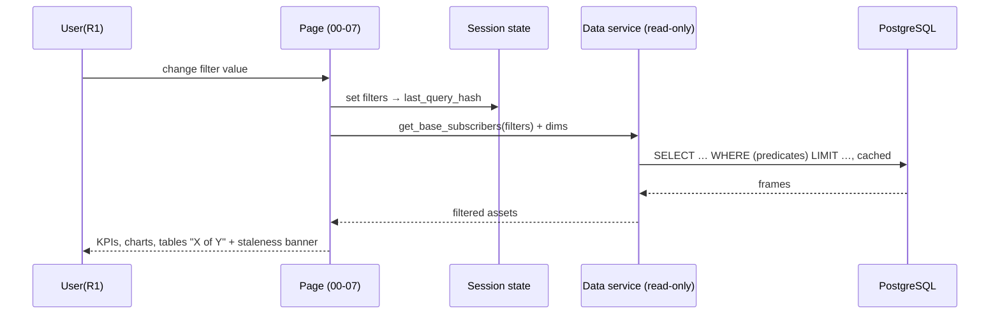
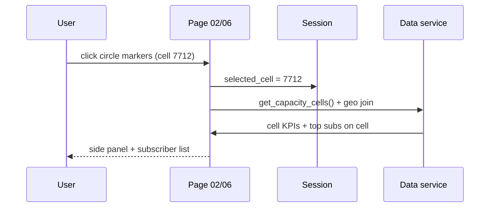
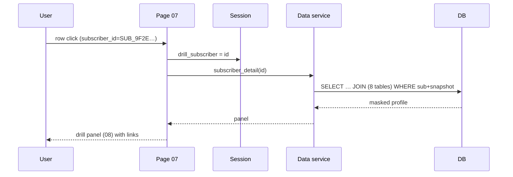
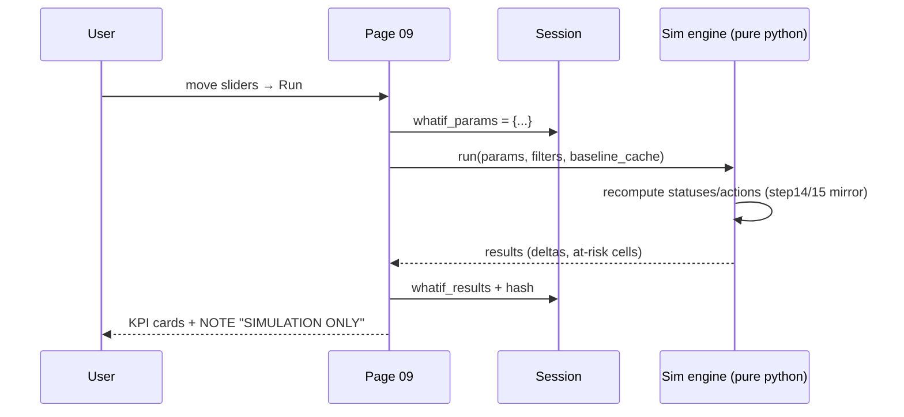
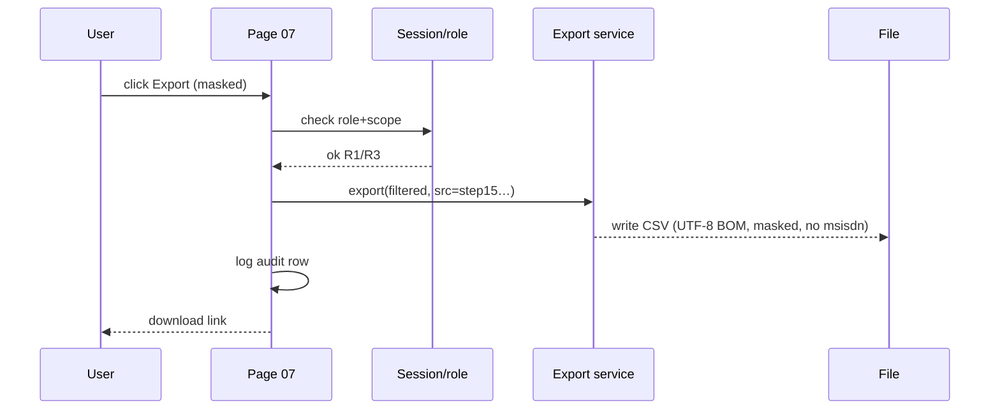
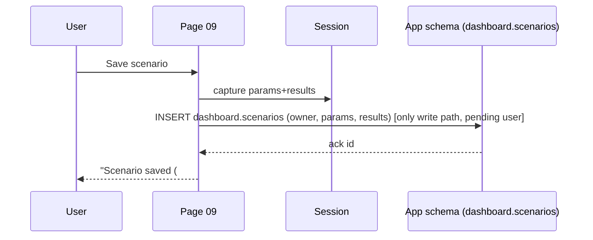
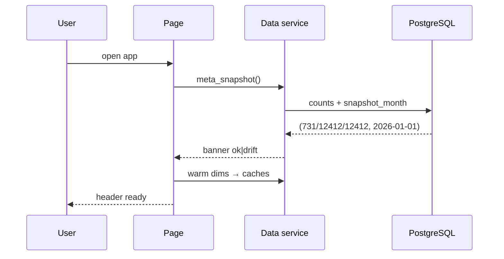

# Interactive 5G FWA Decision-Support Dashboard — Interaction & UX Specification

**Deliverable:** dashboards deployment — UX and interaction design specification (WHAT + HOW to interact), to be consumed by the later implementation phase.
**Evidence base:** read-only investigation of this project (v3 pipeline scripts, live PostgreSQL 18.3, prior dashboard references, report) and the read-only audit report `dashboard_preimplementation_audit.md`. No project file was modified; no application code is specified here.
**Authoring rule:** every fact in this document is tagged `[VERIFIED]` (observed in the live DB or v3 scripts), `[PROPOSED]` (design decision to confirm at kick-off), or `[UNKNOWN]` (no evidence — explicit question for the user).

---

## 1. Scope, Ground Truth & Evidence Labels

### 1.1 Scope of this specification
- Defines **roles, pages, per-page KPIs/charts/filters/tables, interaction contracts, session-state schema, data-access service contracts, what-if simulation behavior, drill-down & export contracts, wireframes, sequence diagrams, and Given/When/Then acceptance criteria** for the dashboard.
- Pipeline execution order, ML internals, and business-rule derivations are **consumed as-is** (see audit §5, §8); this spec only references them as inputs to interactions.
- Explicitly **out of scope**: pipeline retraining, schema migrations, model-versioning work (flagged as dependencies, §16), anything that writes to `cleaned_data.*`.

### 1.2 Evidence labels (used in every section)
| Label | Meaning |
|---|---|
| `[VERIFIED]` | Confirmed via live SELECT queries or v3 script source during the audit (snapshot 2026-01-01). |
| `[PROPOSED]` | Design decision recommended by this spec (must be confirmed before implementation). |
| `[UNKNOWN]` | No direct evidence found locally; explicit question for the user. |

### 1.3 Verified ground truth used throughout
| Item | Value | Status |
|---|---|---|
| Subscribers (ABT) | **12,412** | `[VERIFIED]` |
| Eligible (score > 0) | **2,923** | `[VERIFIED]` |
| Cells (`t3_cell_monthly_kpi`) | **731** | `[VERIFIED]` |
| `campaign_action` | `Contact Now` 731 / `Contact Later` 2,180 / `Manual Review` 12 / `Exclude` 9,489 | `[VERIFIED]` |
| `churn_risk_band` | Low 10,465 / Medium 1,771 / High 176 (no Critical in current snap) | `[VERIFIED]` |
| Capacity status | all 731 `Available`; max PRB p95 = 74.68 | `[VERIFIED]` |
| Step14 rollout | 2,923 rows all `Safe`/`Approved` (no Blocked) | `[VERIFIED]` |
| Score bands (eligible) | Marginal 1,579 / Standard 1,036 / Premium 308 | `[VERIFIED]` |
| `offer_category` | Base Only 1,912 / Base+IPTV 498 / Base+Convergent 343 / Multi-Addon 118 / Base+Gaming 52 | `[VERIFIED]` |
| Personas | 4 clusters: 0=1,074 / 1=1,478 / 2=314 / 3=57 (sum 2,923) | `[VERIFIED]` |
| Geo | lat/lon only in `t4_coverage_address_grid` (Tunis ~36.8/10.2); **not** in ABT | `[VERIFIED]` |
| DB | single `postgres` role, db `postgres`, host `localhost:5432`, no PostGIS | `[VERIFIED]` |
| Indexes | only `idx_abt_sub_month(subscriber_id, snapshot_month)`; no PK/FK/unique | `[VERIFIED]` |
| Joins | all subscriber tables join on `subscriber_id` + `snapshot_month`; cell tables on cell id; `t4_coverage_address_grid` only source of lat/lon | `[VERIFIED]` |

**Column-name reference (verified):** `subscriber_id`, `snapshot_month`, `fwa_suitability_score`, `fwa_suitability_band`, `fwa_suitability_reason`, `churn_probability`, `churn_risk_band`, `offer_category`, `recommended_offer`, `final_priority_score`, `campaign_action`, `rollout_status`, `cluster_id`, `business_label`, `signal_quality_class`, `radio_feasibility_class`, `capacity` status (t3), `latitude`/`longitude` (t4 grid), `address_id`, `dominant_serving_cell_id`.

---

## 2. User Roles

`[PROPOSED]` role model (single-tenant; single-operator in v1). Roles matter primarily because of export masking and visibility of churn/geo data (§12) and what-if write-back constraints.

| ID | Role | Primary need | Pages applicable | Export scope | What-if? |
|---|---|---|---|---|---|
| R1 | Campaign & Sales Analyst | Prioritized campaign list, action queue, drill-down on individual subscribers | Overview, Eligibility, Campaign, Offers, Drill-down, What-if, Export | Masked rows (pseudonymized ID, no msisdn), green-field export | Yes (campaign view) |
| R2 | Capacity / Network Manager | Cell-level headroom, risk, what-if on take-rate/threshold | Overview, Capacity, What-if (capacity view), Map | Masked + cell-level | Yes (capacity params) |
| R3 | Analytics lead / DQ owner | Trust in numbers, data-quality, model versioning | Overview, DQ, Model status, all read pages | Column-mapping allowed, masked | No (read-only) |
| R4 | Business sponsor | Board-level KPIs | Overview, Campaign summary | KPIs-only, no row-level | No |
| R5 | (future) Auditor | Full audit trail of filters/actions | All (read) | Snapshot + log | No |

Cross-cutting rules for ALL roles:
- PII never rendered: `msisdn`, and any address detail beyond governorate/street-level aggregation are excluded; `subscriber_id` shown as `SUB_XXXX…` (verified pseudonym format).
- `churn` labels and full score-reasons visible only to R1–R3.
- No role can issue a write to `cleaned_data.*` (service layer enforces read-only, §8).

---

## 3. User Journeys (per role, primary flows)

### 3.1 R1 Campaign Analyst
1. **Daily funnel check** → Overview → funnel `12,412 → 2,923 → 731 (Contact Now)`; KPI cards; donut of `campaign_action`.
2. **Filter & re-slice** → set global filters (persona, churn band, offer, action) → Campaign page table reflects counts; header KPIs update globally (I1, §7).
3. **Contact-queue focus** → sort by `final_priority_score` desc; filter `campaign_action = Contact Now`; geocode map view optional.
4. **Drill-down** → click a row → subscriber profile panel (§11) with full masked data and the step-chain (score, reason, churn, offer, action).
5. **Simulate** → tweak take-rate/offer multipliers on What-if page → see KPI deltas → export the resulting shortlist (masked).

### 3.2 R2 — Capacity Manager
1. **Cell health triage** → Capacity page: PRB p95 distribution, 80% line, headroom ranking.
2. **What-if load** → raise take-rate → recompute cell PRB uplift (step14 mirror) → see at-risk cells (≥80% Constrained, ≥90% Blocked).
3. **Map** → select a cell → drill to cell KPIs + subscriber mix; export cell report.

### 3.3 R3 — Analytics lead
1. **Data trust check** → DQ page reviews verified pollution counts and freshness tokens; Model page shows pipeline versions and expected row baselines.
2. **Where do numbers come from** → every KPI carries a tooltip/popover with its source table and formula.

### 3.4 R4 — Business sponsor
1. **Weekly pulse** → Overview with 5 cards + 2 charts; no row-level data; export = executive PDF/CSV summary.

---

## 4. Dashboard Pages (Sitemap)

`[PROPOSED]` 10 pages, Streamlit multi-page app in `app/app_pages/`, navigation order enforced by file prefix.

| # | Page (route) | Purpose | Primary role | Global filters apply? |
|---|---|---|---|---|
| 00 | `00_overview` | Executive KPIs, funnel, action donut | R1, R4 | Yes |
| 01 | `01_dataquality` | Pollution DQ (P1–P7), row baselines | R3 | No (global dims limited) |
| 02 | `02_eligibility` | Coverage & eligibility: map + classes | R1, R2 | Yes |
| 03 | `03_clusters` | Persona segmentation | R1, R3 | Yes |
| 04 | `04_churn_risk` | Churn distribution, risk x segment heatmap | R1, R3 | Yes |
| 05 | `05_offers` | Offer recommendations by category | R1 | Yes |
| 06 | `06_capacity` | Cell KPIs, headroom, 80% line | R2 | Yes |
| 07 | `07_campaign` | Final campaign list (table + filters + export) | R1 | Inherits global |
| 08 | `08_drilldown` | Subscriber search & profile | R1 | No (search takes over) |
| 09 | `09_whatif` | What-if simulator (take-rate/multipliers/threshold) | R1, R2 | Yes (scenario scope) |
| 10 | `10_model_status` *(optional)* | Pipeline/snapshot versioning, artifact status | R3 | No |

---

## 5. Page-level Specifications (KPIs, charts, filters, tables)

Common elements every page shares (`[PROPOSED]`):
- **Master filter bar** (collapsible): persona `cluster_id`/`business_label`, `churn_risk_band`, `radio_feasibility_class`, `signal_quality_class`, `offer_category`, `campaign_action`, `snapshot_month` (single value today; dynamic later). Scope: all charts/tables/KPIs on page.
- **KPI row** at top: metric, delta vs baseline (where baseline = current snapshot), source tooltip (table.column), and "filtered X of baseline Y".
- **Empty state**: when a filter combination yields 0 rows, show "No data for this selection" + reset-filters button.
- **Staleness banner**: `snapshot_month` + row-count check vs. verified baselines (churn 10465/1771/176; actions 9489/2180/731/12) — if mismatch, amber banner "Snapshot drift detected" (`[VERIFIED]` baselines, `[PROPOSED]` banner).

### 5.1 Page 00 — Overview (`00_overview`)
- **KPIs** (`[VERIFIED]` baselines): Total **12,412**; Eligible **2,923**; Contact Now **731**; Manual Review **12**; cells max PRB p95 74.68.
- **Charts**:
  1. Funnel (12,412 → 2,923 → 731) — table-driven.
  2. Donut of `campaign_action` (Exclude 9,489 / Contact Later 2,180 / Contact Now 731 / Manual Review 12).
  3. Bar of `churn_risk_band` (Low 10,465 / Medium 1,771 / High 176).
  4. Bar of `radio_feasibility_class` (feasible vs fallback split).
- **Table**: top-10 Contact-Now candidates by `final_priority_score` desc (id pseudo, score, band, action, offer).
- **Filters**: all global filters.

### 5.2 Page 01 — Data Quality (`01_dataquality`)
- **KPIs**: rows read vs repaired per pollution rule P1–P7; residual; freshness (snapshot 2026-01-01).
- **Charts**: bar per pollutant type (P1..P7 repaired counts); freshness tile.
- **Tables**: per-rule log: rule, repaired rows, action taken. **Filters**: none (full snapshot).

### 5.3 Page 02 — Coverage & Eligibility (`02_eligibility`)
- **KPIs**: eligible 2,923; excluded 9,489 (RF 9,449 + fiber cannibalization 40 — `[VERIFIED]`); coverage class counts.
- **Charts**:
  1. Folium circle-marker map (color by class; click → cell context) — lat/lon from `t4_coverage_address_grid` join (only source of geo, `[VERIFIED]`).
  2. Histograms `RSRP` / `SINR` if exposed; stacked bar of `radio_feasibility_class`; donut of score bands (Marginal 1,579 / Standard 1,036 / Premium 308).
- **Table**: top eligible by priority; columns: subscriber_id (pseudo), score, fault, feasibility, signal class, cell.
- **Filters**: feasibility, signal class, score band.

### 5.4 Page 03 — Clusters (`03_clusters`)
- **KPIs**: cluster sizes (0=1,074 / 1=1,478 / 2=314 / 3=57).
- **Charts**: radar à cluster: ARPU band, data volume, tenure band, device generation, heavy flags; bar cluster x `offer_category`; bar cluster x `campaign_action`.
- **Tables**: cluster profile table (`business_label` like `4G-Fallback | Individual | High-Value | Heavy-Streamers`).

### 5.5 Page 04 — Churn Risk (`04_churn_risk`)
- **KPIs**: High 176 / Medium 1,771; mean `churn_probability`.
- **Charts**: histogram of `churn_probability` with band cutoffs (0.15/0.35/0.60); heatmap churn x cluster; bar churn x score band.
- **Table**: at-risk rows (subscriber, band, probability, reason, offer).
- **Filters**: band, cluster, offer, action.

### 5.6 Page 05 — Offers (`05_offers`)
- **KPIs**: counts by `offer_category` (Base Only 1,912 / Base+IPTV 498 / Base+Gaming 52 / Base+Convergent 343 / Multi-Addon 118).
- **Charts**: bar `offer_category`; stacked `offer_category` × `churn_band`; bar `offer_category` × `campaign_action`.
- **Table**: recommendation rows (subscriber, `recommended_offer`, `offer_category`, reason code).

### 5.7 Page 06 — Capacity (`06_capacity`)
- **KPIs**: cells 731; at/over headroom 0 (max p95 74.68); cells-at-risk under simulation N.
- **Charts**: histogram `prb_utilization_p95` with 80% line; scatter p95 × max; cell-level map (lat/lon via `dominant_serving_cell_id` → t4 grid).
- **Table**: cells ranked by PRB p95 desc (cell id, status, p95, max, headroom-to-80%).

### 5.8 Page 07 — Campaign Ops (`07_campaign`)
- **KPIs**: Contact Now 731 / Later 2,180 / Exclude 9,489 / Manual 12; median `final_priority_score`.
- **Charts**: donut `campaign_action`; bar final_priority_score deciles.
- **Table**: full actionable list — `subscriber_id` (pseudo), cluster, score, score band, reason, churn band, offer, action, `final_priority_score`; sort by score desc; pagination 50/100/200 (`[PROPOSED]`); **row click → drill-down I4**; export button (I6).

### 5.9 Page 08 — Drill-Down (`08_drilldown`)
- Search box (subscriber_id / address_id), jump from campaign table click.
- Full masked profile (see §11) + transition mini-history (future snapshots).

### 5.10 Page 09 — What-if (`09_whatif`)
- Slider panel (inputs §10) + baseline vs scenario KPI cards + cells-at-risk table + revert-to-baseline button.

### 5.11 Page 10 — Model Status (`10_model_status`, optional)
- Snapshot metadata: `snapshot_month`, row counts, score-band distribution, artifact tag `[PROPOSED]` (R2 dependency), churn AUC `[UNKNOWN — report conflict 0.7094/0.8956]`.


---

## 6. Interaction Catalog

Identifiers used in all downstream contracts, wireframes, sequence diagrams and acceptance tests.

| ID | Interaction | Actors | Page(s) | Kind |
|---|---|---|---|---|
| I0 | Page load / view init | All | all | system |
| I1 | Global filter change | R1–R3 | all (except 08) | sync |
| I2 | Chart cross-filtering (click/brush selection) | R1–R3 | 00,02,03,04,05,06,07 | sync |
| I3 | Map cell selection | R1,R2 | 02,06 | sync |
| I4 | Subscriber drill-down (row/detail click) | R1 | 07 → 08 | navigation + panel |
| I5 | What-if simulation run | R1,R2 | 09 | async (recompute) |
| I6 | Export (page-scoped or filtered) | R1-R4 | 00,02,06,07,09 | sync/file |
| I7 | Scenario save/load (app-owned sandbox) | R1,R2 | 09 | async (future) |
| I8 | Data-freshness / version check | all | all (global header) | system |

---

## 7. Interaction Contracts

Each contract: **trigger / preconditions / inputs / processing (pseudo-deterministic, cache-aware) / outputs / state changes / errors / idempotency / latency budget** (`[PROPOSED]` unless marked).

### I0 — Page load & init
- Trigger: app start; page navigation.
- Processing: read-only bootstrap: (1) system meta `snapshot_month`+row-count tokens; (2) dimensional assets (personas, classes, offers, actions) → session cache; (3) base dataset headers.
- Outputs: header (snapshot, drift banner), master filter bars enabled.
- Errors: DB unreachable → full-page error + retry button; partial schema drift → banner + disabled features (degrade gracefully).
- Idempotency: yes (pure reads); cache key = `(snapshot_month, table list, counts)`.
- Target latency <= 2 s (verified row volumes 12k/731 are small).

### I1 — Global filter application
- Trigger: any master-bar control change (multi-select persona/band/class/offer/action; maybe single-select snapshot_month).
- Inputs: `filters = {snapshot_month?, cluster_ids, churn_bands, feasibility_classes, signal_classes, offer_categories, campaign_actions}`.
- Processing: **SQL-side predicate pushdown** on indexed-ish joins (12k rows; single index exists) — plain `WHERE ... AND`; no app-side filtering of base tables. All charts/tables/KPIs re-evaluate on filtered frames.
- Output: every widget on page updates; header shows "filtered X of baseline Y".
- State: `session.filters` updated; `session.last_query_hash` changed; existing what-if scenario marked stale (I5 note).
- Errors: invalid combination → 0 rows → empty state widget; no SQL errors (defensive).
- Idempotency: yes. Latency <= 1.5 s.

### I2 — Cross-filtering (chart selection)
- Trigger: click on a chart mark (bar/heatmap/donut segment; scatter brush).
- Processing rule: the selected dimension slices **all other widgets** on the page (single-source sync); re-clicking empties the selection (toggle). Charts re-query on selected subset via a precomputed local frame join; **no new DB round-trip** (base snapshot already in-memory: 12,412 rows).
- Outputs: other widgets recomputed; selection chip shown in filter bar; option to clear/convert selection to a global filter (promote).
- Errors: multiple incompatible selections (persona + churn intersection impossible) → union semantics documented; note in empty state.
- Idempotency: yes.

### I3 — Map cell selection
- Trigger: click on circle markers in map rows (02/06).
- Inputs: `selected_cell_id` (cell), geo point.
- Processing: fetch cell KPIs for that cell (`t3_cell_monthly_kpi` + step14 sim status) and its subscriber mix (join `t4` … via `dominant_serving_cell_id`).
- Outputs: side panel “Cell 12345 — p95 62.1 | max 74.1 | capacity Available | headroom 7.9” + list of top-N subscribers on that cell + action to drill (I4).
- Errors: no cell matched → toast; coords null (missing geo) → show table-only view.
- Idempotency: yes (state keyed by cell id).

### I4 — Subscriber drill-down
- Trigger: click campaign-table row (07) or search box (08).
- Inputs: `subscriber_id`.
- Processing: `get_subscriber_detail(id)`: joins ABT + score cols + cluster + churn + offer + campaign + coverage (geo) → masked profile (PII aware).
- Outputs: full profile panel (§11) + links (open in map, open in what-if as seed) + Export-row.
- Errors: ID not found → toast; no-tie cases (missing churn row) → "no churn record".
- Idempotency: yes; single-row query <= 50 ms.

### I5 — What-if simulation
- Trigger: “Run simulation” button; param changes to sliders.
- Inputs: params `take_rate %`, `capacity threshold (default 80)`, `offer multiplier` ×1.0/1.25/1.5 (selective per category), `PRB uplift cap` (step14 mirror: min(p95 + uplift, cap 100)), `stage eligibility` (on/off), plus optional scope subset (filters/geo).
- Processing: deterministic mirror of step14/15 math (see §10) — recompute aggregated post-PRB per cell, re-derive rollout_status (Safe/Waitlist/Blocked), rebuild campaign_action via gate rule (Exclude > Waitlist > Manual Review > Contact Now > Contact Later). Pure Python; no DB in the loop; bounded iteration (loop over 731 cells).
- Outputs: baseline-vs-scenario KPI cards (contact-now volume, cells at constraint, added/freed capacity), at-risk cells list, updated funnel; all changes **in-memory only** (explicit UI label “SIMULATION — no data was written”).
- State: `session.whatif = {params, results, version}`, marked stale when filters change.
- Errors: invalid params → clamp + warning; cache hit → no recompute.
- Idempotency: deterministic; cache key = hash(params + filter context).

### I6 — Export
- Trigger: Export button (rows = current filtered view on page; or full-month default).
- Contract (§12): CSV (UTF-8 with BOM), columns per role; masked PII; filename `fwa_<page>_<snapshot>_<hash>.csv`; export button disabled when 0 rows; audit appended to session log; export includes footer legend? (No — file header row only).
- Latency budget: 12k-row export < 2 s; chunked background for >50k in future.

### I7 — Scenario save (future / `[PROPOSED]`)
- Trigger: “Save scenario as…” in What-if panel.
- Processing: writes ONLY to app-owned schema `dashboard.scenarios` (id, owner, params JSON, results JSON, created_at) — never touching `cleaned_data.*`.
- Outputs: scenario library list in what-if page; loadable to reproduce a view.
- Pending: awaiting user approval for this write path (UNKNOWN).

### I8 — Data-freshness / version check (system)
- Trigger: on load + every 5 min (lazy interval).
- Processing: counts query on `t3_cell_monthly_kpi`, `abt_subscriber_month`, `step15_final_campaign_list` vs expected 731/12,412/12,412; `snapshot_month` expected 2026-01-01.
- Outputs: global banner state `ok | drift`; triggers log entry; if drift and page uses affected table → amber banner (never blocks).


---

## 8. Data-Access Service Contracts

`[PROPOSED]` read-only service layer (psycopg2 pool or SQLAlchemy engine, `pool_pre_ping`). All queries are plain `SELECT`s; a read-only engine guard prevents any DDL/DML path.

### 8.1 Universal rules
- All subscriber queries parameterized on `snapshot_month` (single month today, future-proof).
- Join key contract (`[VERIFIED]`): `subscriber_id + snapshot_month` across ABT/cluster/churn/offer/campaign/step14; `address_id` for T4 coverage; cell via `dominant_serving_cell_id` (step14) → `t3_cell_monthly_kpi`; geo only in `t4_coverage_address_grid`.
- **Geo contract**: maps ALWAYS join `t4_coverage_address_grid (latitude, longitude, address_id)` — no other table exposes lat/lon in the ABT (`[VERIFIED]`).
- **PII contract**: `msisdn` (verified PII) excluded at every query; `subscriber_id` pseudonymized at boundary; export dual-masked (§12).

### 8.2 Service functions
| Function | Inputs | Returns (sources) | Notes |
|---|---|---|---|
| `meta_snapshot()` | — | `{snapshot_month, counts{cell=731, abt=12412, campaign=12412}, bands, actions}` | freshness for I8 |
| `base_subscribers(filters)` | filter set (I1) | `abt_subscriber_month` rows (53 cols) | SQL-side predicates |
| `dim_personas()` | — | cluster_id, business_label, size | `abt_subscriber_month_clustered` |
| `churn(filters)` | filters | `churn_probability, churn_risk_band` + ids | `step12_churn_predictions` |
| `offers(filters)` | filters | `recommended_offer, offer_category, reason` | `step13_recommendations` |
| `campaign(filters, sort, page)` | filters | `final_priority_score, campaign_action, rollout_status…` | `step15_final_campaign_list`, SQL sort/page |
| `capacity_cells()` | — | cell id, PRB p95/max, capacity status, headroom | `t3_cell_monthly_kpi` |
| `capacity_sim(filters)` | filters | per-subscriber post-PRB + status | `step14_capacity_simulation` |
| `geo(class_filter)` | class | lat/lon + coverage classes | `t4_coverage_address_grid` ⋈ `t4_coverage_features` |
| `subscriber_detail(id)` | subscriber_id | masked joined profile | I4 |
| `whatif_inputs()` | filters | score, `num_active_lines`, cell, offer per row | cached base for I5 |

Cache policy (`[PROPOSED]`): `st.cache_data(ttl=30min, hashed_on=filters+snapshot)` for dimension sets; never cache detail (I4) longer than page session; invalidate global cache on I8 drift.

---

## 9. Session-State Schema

`[PROPOSED]` `st.session_state` keys (all dashboards use `session.*` prefix to avoid collisions with library keys).

| Key | Type | Owner writes | Owner reads | Reset on |
|---|---|---|---|---|
| `session.ready` | bool | I0 | all | app boot |
| `session.filters` | dict (7 keys §I1) | I1, I2 (promote) | all pages | reset button |
| `session.last_query_hash` | str | I0 | all | filter change |
| `session.selected_cell` | str\|None | I3 | 02, 06 | cell cleared/page reset |
| `session.drill_subscriber` | str\|None | I4 | 08, 07 | navigation |
| `session.whatif_params` | dict | I5 | 09 | slider change / reset |
| `session.whatif_results` | dict | I5 | 09 | run results / reset |
| `session.whatif_baseline` | dict | I0,I8 | 09 | snapshot drift |
| `session.export_ctx` | dict | I6 | 07,00 | export done / page change |
| `session.drift` | bool + payload | I8 | header, pages | interval check PASS |
| `session.role` | str | login (mock in v1) | all | logout/session end |
| `session.audit_log` | list (rows) | I6, I5 | 08,10 (future) | — |

**Rules:**
- All keys namespaced; UI keyed by their owning interaction; every write goes through a `state.set(...)` helper with validation.
- What-if results are recomputed when `session.filters.hash` changes (marked stale, I5).
- No key survives outside the session; exported audit trail is app-log, not session state.
- `session.whatif_*` are the only state that "looks like data" — never persisted to `cleaned_data` (§7 I7; write to `dashboard.scenarios` only if approved [UNKNOWN]).


---

## 10. What-If Simulation Behavior Specification

### 10.1 Objective
Predictable, in-memory, deterministic "what happens if we target more/fewer subscribers" for campaign and capacity owners — mirrors the step14/step15 math (`[VERIFIED]` formulas, `[PROPOSED]` parameter surface).

### 10.2 Parameters (input contract)
| Param | Range/step | Default | Effect |
|---|---|---|---|
| `take_rate` (%) | 0–100, step 5 | 20 | share of currently `Contact Now` eligible actually converting |
| `offer_multiplier` | {1.0, 1.25, 1.5} | 1.0 | scaling of post-PRB demand per offer category |
| `capacity_threshold` (%) | 50–100 | 80 | constraint line (same as step5/step14 `[VERIFIED]` 80) |
| `prb_uplift_cap` (%) | 0–30, step 1 | 15 | step14-equivalent uplift cap (mirrors script constant) |
| `scope` | filter subset | current filters | run on current global filter set (overrides only cells/match) |
| `recompute_base` | toggle | off | re-derive step14 statuses from scratch (default: use precomputed baseline) |

### 10.3 Computation (deterministic algorithm, no DB)
```
post_prb(cell) = min(base_prb_p95(cell) + uplift_take(take_rate, multiplier), 100)
   uplift_take = take_rate/100 × prb_uplift_cap × per_cell_eligible_share
status(cell) = post_prb ≥ 90 → Blocked ; ≥ 80 → Constrained ; else Safe   (thresholds from step14, [VERIFIED])
action(sub)   = gate applied in step15 order: Exclude > Waitlist > Manual Review > Contact Now > Contact Later
final_priority = final_priority_score (unchanged; recomputation only of action transitions)
```
All parameters clamps at draw; results attributable per cell and per subscriber.

### 10.4 Outputs (output contract)
- KPI delta cards: `Contact Now` count before/after, cells `Constrained/Blocked` before/after, avg headroom delta, candidates whose action changed.
- At-risk cell table (id, base p95, post p95, status, delta) — top-20 sortable.
- Funnel update + offer-category mix view.
- Explicit inline note: “SIMULATION ONLY — no data written”; a “Revert to baseline” button restores `session.whatif_*` to baseline.
- Scenario hash/cache: identical params → identical result (deterministic; unit tests enforce).

### 10.5 State flow
`params → compute → results (baseline | scenario) → cached by hash → if filters change mark stale`.

---

## 11. Drill-Down Specification

### 11.1 Entry points
- I4 row click in Campaign table (07); search by `subscriber_id`/`address_id` (08); cell click from Map (02/06) → cell panel + subscriber list → drill again.

### 11.2 Subscriber profile panel (08)
Sections (all `[VERIFIED]` sources):
1. **Header**: pseudo-ID `SUB_…`, band Pill (Marginal/Standard/Premium), cluster `business_label`.
2. **Suitability**: `fwa_suitability_score`, band, reason chain (score −20/−15/−10 hard-stop reasons incl. `Fiber_Cannibalization`/`RF` — reason list `[VERIFIED]` shape).
3. **Behaviour & mono**: churn probability + band, data volumes, tenure, device 5G ready, heavy flags (streaming/gaming/VoIP).
4. **Persona**: cluster id, label, weight.
5. **Offer**: `recommended_offer`, `offer_category`, reasoning; primary/tier2 candidates.
6. **Campaign**: `final_priority_score`, `campaign_action`, `rollout_status`.
7. **Network**: dominant cell, coverage class (`signal_quality_class`/`radio_feasibility_class`), geo point (t4 grid) “open in map”.
8. **Raw facts**: `snapshot_month`, `num_active_lines` (verified pseudo col), any rule violations.
- PII masking: `subscriber_id` shown pseudo; `msisdn` never fetched (`[VERIFIED] rule`); address aggregated; export mask again.

### 11.3 Cell drill panel (02, 06)
- Cell stats: p95/max PRB, status, headroom-to-80%; step14 sim status for the cell; top-10 subscribers of that cell (join on `dominant_serving_cell_id`); action: “open all these subscribers in Campaign page”.

---

## 12. Export Specification

### 12.1 Export contract (I6)
| Item | Spec |
|---|---|
| Formats | CSV (UTF-8 with BOM) v1; XLSX multi-sheet optional later |
| Scope | current page + active global filters; default = full snapshot |
| Columns | page column set per §5 table defs, plus `snapshot_month`, `exported_at`; NEVER `msisdn`; ID masked (`SUB_…`) |
| Auth | role-based merge (`R4` gets KPIs-only bundle: counts, not rows) |
| Naming | `fwa_<page_slug>_<snapshot_yyyymm>_<runcode>.csv`; row count in first line comment? → no, header added; `…_n/count.csv` |
| Throughput | 12,412-row export < 2 s; background for > 50k (future) |
| Logging | every export appended to session audit log (who, page, filters hash, count) |
| Empty | disabled button + info when 0 rows |

### 12.2 Masking rules (row- and column-level)
- Column mask: PII (`msisdn`), any address street-level → excluded.
- Row mask: R4 bundle = aggregate only (no row-level export).
- Test: exported CSV must not contain `msisdn` pattern (unit test).


---

## 13. Wireframes (ASCII)

### 13.0 Global skeleton (every page)
```
┌──────────────────────────────────────────────────────────────────────────────┐
│ ▓ 5G FWA DECISION DASHBOARD ▓  snapshot: 2026-01-01  ▓ [drift-amber?]  ▓ R1  │
├─────────────┬────────────────────────────────────────────────────────────────┤
│ NAV          │   [master filter bar (collapsible)]                            │
│ 00 Overview  │   persona ▾ | churn ▾ | feasibility ▾ | offer ▾ | action ▾ |   │
│ 01 DataQual  │   ▾ snapshot ▾      [Reset]  [Apply(I1)]                       │
│ 02 Coverage  │────────────────────────────────────────────────────────────    │
│ 03 Clusters  │   [KPI1][KPI2][KPI3][KPI4]                                    │
│ 04 ChurnRisk │   ┌────────────┬────────────┐                        │
│ 05 Offers    │   │ funnel     │ action     │                        │
│ 06 Capacity  │   │ 12,412 →   │ donut      │                        │
│ 07 Campaign  │   │ 2,923 →731 │            │                        │
│ 09 What-if   │   └────────────┴────────────┘                        │
│ (10 Model)   │   [table: top 10 Contact Now] [export I6]            │
├─────────────┴────────────────────────────────────────────────────────────────┤
│  footer: sources read-only • PII masked • help?                              │
└──────────────────────────────────────────────────────────────────────────────┘
```

### 13.1 Page 02 Coverage & Eligibility
```
[KPI eligible 2,923 | excluded 9,489 | 5G_Feasible n | score-band donut |]
┌─────────────────────────────┬──────────────────────────────────┐
│ map (folium circle markers) │ ▸ class legend:                 │
│   • 5G_Feasible ●4G_Fallback│   toggle signal class ▾         │
│   ●Infeasible  ●Fiber_C     │ [click cell → panel]            │
└─────────────────────────────┴──────────────────────────────────┘
[table: top eligible rows . . .]
```

### 13.2 Page 06 Capacity
```
[KPI cells 731 | 0 at/80 | max 74.68 | sim-risk N]
[histogram: PRB p95 with 80% line] [scatter p95×max] [cell map]
[table cells: id │ p95 │ max │ status │ headroom]
```

### 13.3 Page 07 Campaign + Page 09 What-if
```
07: [funnel mini][donut action][top decile table: sel → I4 drill `SUB…`]
09: ┌ sliders/toggles ┐ ┌ KPI delta cards ┐
    │ ☐ take 20%      │ │ Contact Now 731 → 804 (+73) │
    │ ☐ offer ×1.25    │ │ cells at-risk 0 → 12       │
    │ ☐ threshold 80  │ │ [at-risk cell table]        │
    └ [Run] [Revert] ┘ └ [SIMULATION ONLY label]     ┘
```

### 13.4 Drill Panel (I4)
```
SUB_9F2A…  █ Premium █  cluster: 4G-Fallback|Individual|High-Value|Heavy-Streamers
score 92 (band Premium)  reason: 5G piggyback | churn 0.08 Low
offer: 5G FWA Postpaid + IPTV   action: Contact Now (priority 512)
[open in map] [export info]
```

---

## 14. Sequence Diagrams (Mermaid)

### 14.1 I1 — Global filters


### 14.2 I2 — Cross-filtering
```mermaid
sequenceDiagram
    participant U as User
    participant P as Page
    participant S as Session
    U->>P: click chart mark (dim=cluster 2)
    P->>S: promote selection to temporary filter subset
    S-->>P: confirm subset
    P->>P: recompute all widgets from in-memory frame (no DB)
    P-->>U: all widgets reflect selection; chip in filter bar
```

### 14.3 I3 — Map cell selection


### 14.4 I4 — Subscriber drill-down


### 14.5 I5 — What-if simulation


### 14.6 I6 — Export


### 14.7 I7 — Scenario save (future)

*(write to `dashboard.scenarios` requires user approval — `[UNKNOWN]`.)*

### 14.8 I0 — Page init / freshness



---

## 15. Acceptance Criteria (Given/When/Then)

All criteria are testable end-to-end on the verified snapshot (2026-01-01). Baselines in criteria are the verified counts (§1.3).

### I0 — Init
- GIVEN a fresh session; WHEN the app loads; THEN header shows `snapshot 2026-01-01` and nav renders 10 pages, within 2 s.
- GIVEN DB is reachable; WHEN counts mismatch expected (731/12,412); THEN amber drift banner appears; dashboard still renders.

### I1 — Global filters
- GIVEN no filters; WHEN user selects `campaign_action = Contact Now`; THEN every widget shows only the 731 Contact-Now rows and header shows "731 of 12,412".
- GIVEN multi-selects; WHEN a combination yields 0 rows; THEN empty-state message + Reset button shown; no chart errors.
- GIVEN filter active; WHEN user clicks Reset; THEN all KPIs return to verified baselines.

### I2 — Cross-filtering
- GIVEN Overview; WHEN clicking donut segment "Contact Now"; THEN funnel and table re-render for that subset (in-memory < 100 ms).
- GIVEN a promoted selection; WHEN clearing it; THEN widgets return to previous filter state.

### I3 — Map cell selection
- GIVEN Coverage map; WHEN clicking a marker; THEN side panel shows that cell's PRB p95/max/status/headroom and its top subscribers.
- GIVEN a cell with null geo; WHEN clicked; THEN table-only fallback is shown (no crash).

### I4 — Drill-down
- GIVEN a campaign row; WHEN clicked; THEN profile panel shows 8 sections with masked ID and no `msisdn`.
- GIVEN a subscriber id not in the snapshot; WHEN searched; THEN "not found" toast; no state corruption.
- GIVEN profile panel; WHEN exporting info row; THEN export obeys role masking (§12).

### I5 — What-if
- GIVEN default params; WHEN pressing Run without changes; THEN results equal baseline (identity check) and note "SIMULATION ONLY" is visible.
- GIVEN take-rate 100 and multiplier 1.5; WHEN Run; THEN at-risk cell list changes deterministically and KPI delta cards show new counts; two identical runs produce identical output.
- GIVEN filters changed after a run; WHEN navigating back to What-if; THEN scenario marked stale; recompute on demand.

### I6 — Export
- GIVEN Campaign page with filters; WHEN Export; THEN CSV contains only masked columns (no `msisdn`), UTF-8 BOM, name `fwa_campaign_202601_<hash>.csv`, row count = filtered count.
- GIVEN role R4; WHEN exporting; THEN only aggregate bundle (no row-level).

### I7 — Scenario save (future)
- GIVEN approved write path; WHEN saving; THEN row exists in `dashboard.scenarios` only; no `cleaned_data` write (guard test).

### I8 — Freshness
- GIVEN drift state; WHEN counters re-checked and OK; THEN banner clears automatically; cache invalidated once.

---

## 16. Interaction Risk Assessment & Implementation-Ready Summary

### 16.1 Interaction-level risks
| Risk | Interaction | L | I | Mitigation |
|---|---|---|---|---|
| No lat/lon in ABT (geo join required) | I3 | M | M | service-level geo join; fallback table view |
| Step9 score persistence only in CSV + manual DB cols → future re-seed breaks 10–15 | I4/I5 | H | H | dashboard consumes DB cols; pipeline fix R1 (audit) required before re-runs |
| No serialized model artifacts → no live inference | I5 (churn re-score) | H | M | precomputed churn; artifact packaging later (audit R2) |
| Single index; no PK/FK → slow ad-hoc filters at scale | I1/I4 | M | L | SQL predicates on 12k rows fine; add indexes only if volume grows |
| Metrics conflict (AUC 0.7094/0.8956; churn 10.2%/6.7%) | I0/I8 | M | M | reconcile authoritative figures with user before UI copy; label source on each KPI |
| Export leakage (msisdn/address) | I6 | M | H | column whitelist + unit test that scans exports for forbidden patterns |
| What-if mismatch vs pipeline if mirror drifts | I5 | M | M | version-pinned mirror + regression tests vs step14/15 outputs |
| Cross-filter heavy interaction (12k rows in-memory) | I2 | L | L | bounded frames; test 380k-rows future with degradation flag |
| Scenario write path (future) | I7 | M | M | app-owned schema only; guard tests; pending user approval |

### 16.2 Implementation-ready summary
- **What to build first (Phase A):** init (I0), master filters (I1), Overview (00) with verified baselines, read-only service layer with the 11 contracts (§8), session-state schema (§9), drift check (I8).
- **Phase B:** Eligibility map (I3), Campaign table + drill-down (I4), Export (I6) with masking tests.
- **Phase C:** What-if engine (I5) with deterministic unit tests; scenario save (I7) pending user decision.
- **Phase D (optional):** model-status page + artifact packaging (depends on audit R2 decision).
- **Non-negotiable:** read-only DB; masked PII; every KPI labelled with source; every interaction idempotent and cache-consistent.
- **Open decisions (`[UNKNOWN]`)**:
  1. Canonical step9 score source (CSV vs DB columns) — R1.
  2. Whether live churn re-inference is required (R2 artifact packaging).
  3. Authoritative AUC/churn-base figures for UI copy.
  4. Approval for `dashboard.scenarios` write path (I7).
  5. Refresh cadence (weekly pipeline? — caching TTL).
  6. Role provisioning in v1 (single operator vs R1–R4 mock roles).

---

*End of `dashboard_interaction_spec.md` — 16 sections, read-only, no code.*
