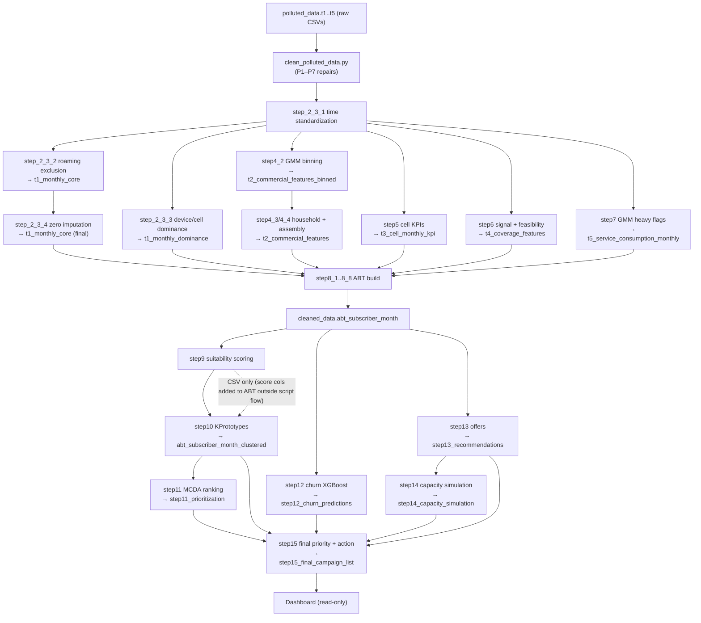
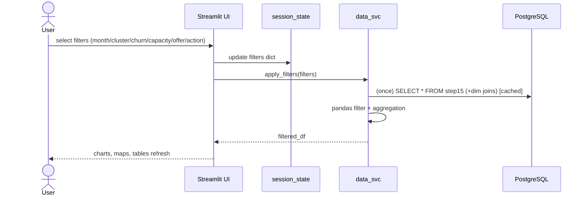
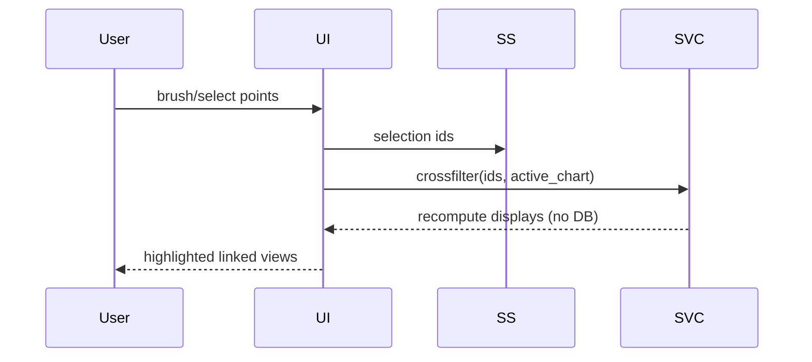
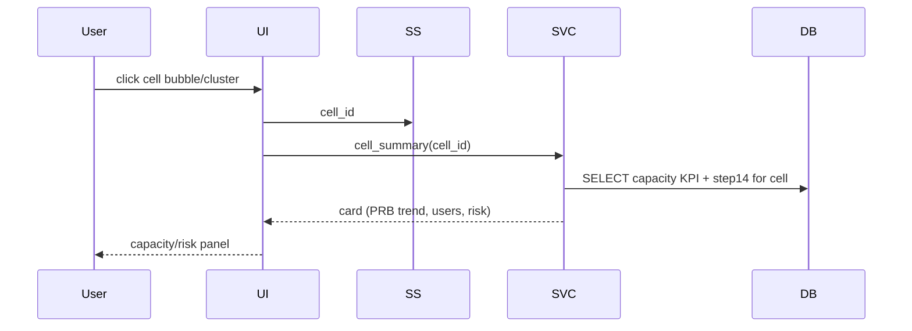
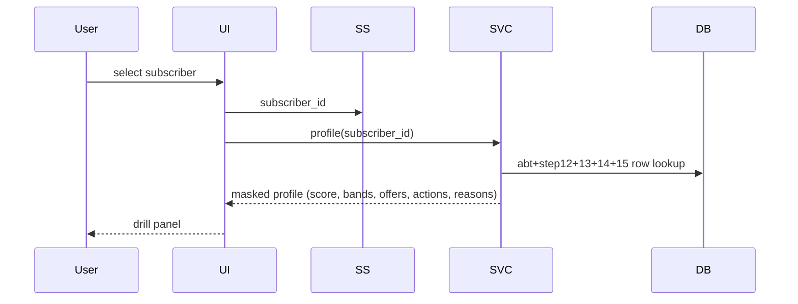
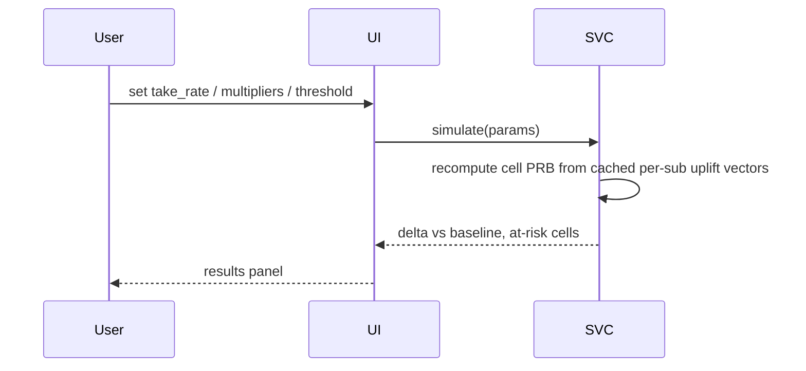
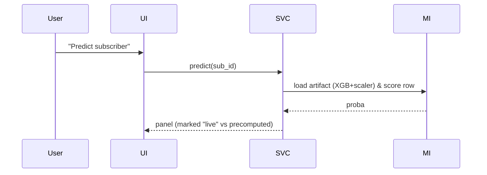
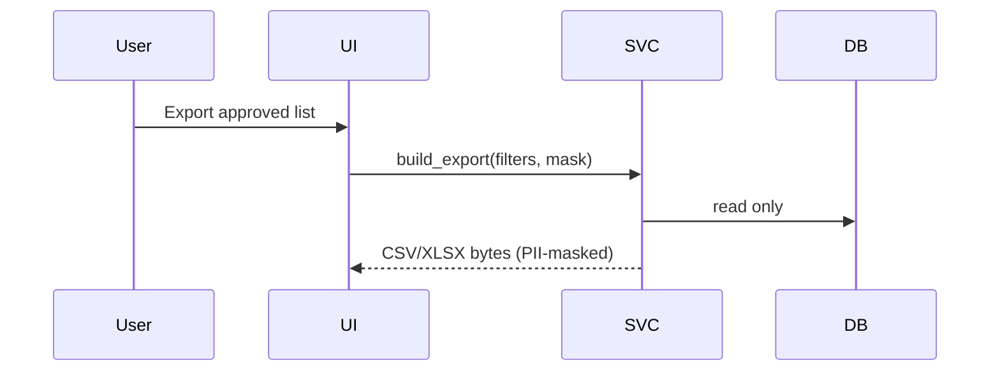
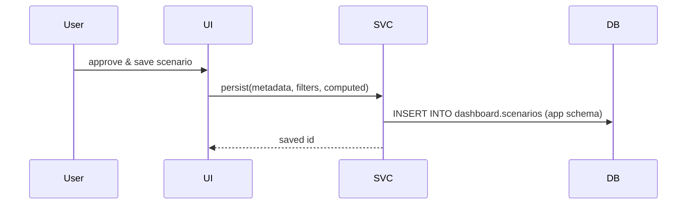

# Dashboard Pre-Implementation Audit
## Interactive 5G FWA Decision-Support Dashboard — Read-Only Investigation Report

Date of investigation: 2026-08-08
Scope: `C:\Users\w50057230\Downloads\FWA project` (all folders), live PostgreSQL 18.3 instance, `.venv` package inventory. No files were created, modified, deleted or migrated inside the project. All database access was read-only (`SELECT`, `information_schema`, `pg_catalog`). No models were retrained. No packages installed.

---

## 1. Executive Summary

The project is a complete **5G FWA (Fixed Wireless Access) migration-decision analytics pipeline** for a Tunisian telecom operator (Huawei Northern Africa / SUP'COM internship). The pipeline processes 5 synthetic-but-realistic tables (T1–T5), cleans 7 injected pollution patterns, builds a 12,412-subscriber analytical base table, and outputs a fully-prioritized campaign list of 12,412 subscribers with offers, churn risk, capacity simulation and campaign actions.

**Dashboard-readiness status: READY.** The pipeline is complete, its outputs are already persisted in a live PostgreSQL 18.3 database on `localhost:5432`, and the environment already contains every package needed to build the dashboard (`streamlit 1.57`, `plotly 6.7`, `folium 0.20`, `streamlit-folium`, `geopandas`, `pydeck`, `xgboost`, `scikit-learn`, `sqlalchemy`, `psycopg2`). A previous-generation Streamlit dashboard exists in `archive v2` and is a proven-but-incomplete reference.

**Recommended dashboard data source:** `cleaned_data.step15_final_campaign_list` (subscriber-level), `cleaned_data.t4_coverage_address_grid` + `cleaned_data.t4_coverage_features` (geo layer), `cleaned_data.t3_cell_monthly_kpi` + `cleaned_data.step14_capacity_simulation` (cell/capacity), `cleaned_data.abt_subscriber_month` (full ABT for drill-down). The legacy `analytics.*` tables are outputs of the older v2 iteration and should NOT be consumed by the new dashboard.

**Three critical findings**
1. No ML artifacts exist: models are trained in-memory per run and never saved. The dashboard cannot perform live inference without new code that serializes models and preprocessing, or it must read precomputed columns from the DB.
2. Credentials are hard-coded (non-production pattern) — secrets must move to environment variables / `.env` / secrets manager before deployment.
3. Only ONE database index exists (`idx_abt_subscriber_month`), which is acceptable at current table sizes (12k rows) but must be planned for larger data.

**The dashboard should be read-only** for pipeline tables (`cleaned_data.*`, `fwa_cleaned.*`, `polluted_data.*`, `analytics.*`); any "save scenario" interaction needs a new write schema owned by the app.

---

## 2. Investigation Scope

- **Read-only inspection** of 1000+ files across: project root (v3 pipeline), `archive v2` (v2 pipeline + old Streamlit dashboard), `archive_v1` (v1 iteration + Grafana dashboards + PostgreSQL tooling), `report_v3`, `report_v4` (LaTeX report sources + figures), `figures`, `polluted data` (raw polluted CSVs).
- **Read-only DB audit** of the live PostgreSQL instance: schemas, tables, columns, indexes, constraints, estimates, freshness, sample rows (masked).
- **Environment inventory:** `.venv` packages, Python 3.12.10.
- **Excluded from listing:** `.git`, `.venv`, `__pycache__`, `.obsidian` internals, LaTeX aux files, large generated-image folders (summarized).
- **Not executed:** any pipeline step, training, migrations, or any write command. No `.py` was imported/run except read-only DB connector scripts written to the OS temp dir.

**Verified vs assumptions:** everything marked *Verified* was confirmed by reading files or running read-only queries. Items marked *Unverified* or *Assumption* are flagged.

---

## 3. Project Tree

Abbreviated tree (folders summarized; files grouped):

```
FWA project/
├── AGENTS.md, opencode.json, 5G_FWA_Internship_Proposal.pdf
├── FWA_steps1.1.txt / FWA steps1.1.txt        # pipeline brief (spec) — verified authoritative spec
├── FWA_Dataset_Schema.xlsx                    # expected input schema (Unverified content — binary, see §21)
├── abt_feature_dictionary.json                # 50-column ABT dictionary (generated by step8_8)
├── pollution_results.txt                      # pollution-detection run log (generated)
├── current_v3/                                # EMPTY directory (placeholder)
├── polluted data/                             # raw polluted CSVs: T1(52 MB), T2, T3, T4, T5 + tun_admin0.geojson
├── figures/                                   # 7 validation PNGs (report figure cache)
├── .venv/                                     # Python 3.12.10 venv (NOT part of source)
│── [v3 pipeline — 31 root scripts]            # step_2_3_1...step15 + helper scripts (see §4)
│── [v3 outputs — root CSVs]                   # step9_fwa_suitability_scores.csv, step10_cluster_profiles.csv, step11_prioritization_output.csv
├── archive v2/                                # v2 iteration: ETL steps, old Streamlit fwa_dashboard, LaTeX report, .streamlit/secrets.toml
├── archive_v1/                                # v1 iteration: PostgreSQL deploy/inject scripts, Grafana dashboards, docker-compose, legacy SQL
├── report_v3/                                 # LaTeX report v3 sources + figures + pptx generators (generated/maintained)
├── report_v4/                                 # current LaTeX report sources (chapters/, config/, figures/, figures_v3/, *.mmd diagrams)
└── current_v3/                                 # empty

```

## 4. Important-File Inventory

Legend for classification: **[A] active** (used by the current production flow), **[O] obsolete**, **[X] experimental**, **[G] generated** (artifact).

### 4.1 Pipeline brief + spec (root)
| Path | Purpose | Inputs | Outputs | Notes | Class |
|---|---|---|---|---|---|
| `FWA_steps1.5.txt` | Authoritative pipeline brief: table roles, grains, 15 steps, business rules, 80% PRB, output schema | — | — | Same content as `FWA steps1.1.txt` | A |
| `FWA_Dataset_Schema.xlsx` | Expected source schema of T1–T5 | — | — | Binary; not read. Refer to schema docs in brief | U |
| `abt_feature_dictionary.json` | ABT feature dictionary written by step8_8 | ABT columns | JSON | Verified: 50-col dict (confirmed first 50 cols) | G |

### 4.2 v3 pipeline scripts (root)
All 31 scripts connect to **PostgreSQL 18.3 @ localhost / db `postgres` / schema `cleaned_data`** with **hard-coded credentials** (password value [REDACTED] — never environment-driven).

| Path | Purpose | Inputs (schema.table) | Outputs (schema.table) | Key functions | Notes | Class |
|---|---|---|---|---|---|---|
| `clean_polluted_data.py` | Detect + repair 7 pollution patterns; write the clean layer | `polluted_data.t1..t5` | `cleaned_data.t1_subscriber_daily_profile`, `t3_ran_kpi_cell_l_daily`, `t4_coverage_address_grid`, `t5_service_consumption_monthly` | `to_num()` | P1 PRB>=99.9&users=0; P2 VoIP>5000&SM=0; P3 RSRP−81..−79&SINR−1..1; P4 >1 msisdn; P5 null kpi_date→delete. Runs everything at import — not safe to import | A |
| `step_2_3_1_time_frame_standardization.py` | Standardize temporal columns to `snapshot_month` (day==1, single month) | t1,t3,t2,t5 `cleaned_data` | rewritten same tables | `standardize_temporal_dimension()`, `validate_temporal_integrity()` | Safe module | A |
| `step_2_3_2_t1_roaming_exclusion_aggregation.py` | Roaming exclusion + daily→monthly T1 aggregation | `t1_daily` | `cleaned_data.t1_monthly_core` (subscriber_id, snapshot_month, monthly_total_gb, monthly_sessions) | `filter_and_aggregate_t1()` | excluded `roaming_flag==True`; MB→GB divide by 1024 | A |
| `step_2_3_3_t1_device_cell_dominance.py` | dominant device + serving cell (mode) + `device_5g_ready_flag` | `t1_daily` | `cleaned_data.t1_monthly_dominance` (`dominant_device_generation`, `dominant_serving_cell_id`, `device_5g_ready_flag`) | `calculate_dominance_features()` | deterministic tiebreak `value_counts().index[0]` | A |
| `step_2_3_4_t1_zero_imputation_peak_ratio.py` | zero-impute DL volumes w/ median; `monthly_peak_hour_ratio` | t1_daily+t1_monthly_core | t1_monthly_core (2 new cols) | `calculate_meand_ratio()` | ratio>0.30 = high-peak (business threshold) | A |
| `step4_2_dynamic_binning_gmm.py` | 1D-GMM (K=2, random_state=42) intersection thresholds for ARPU & tenure | `t2_commercial_features_raw` | `cleaned_data.t2_commercial_features_binned` (arpu_band, tenure_band) | `calculate_gmm_threshold()` | Threshold ARPU=23.33 TND, tenure=90.59 months. Min band share ≥5% else abort | A |
| `step4_3_household_lineage_engineering.py` | `multi_line_flag = num_active_lines > 1` | t2_binned | `t2_commercial_features_household` | `extract_and_engineer()` | | A |
| `step4_4_final_t2_assembly.py` | final T2 features (11 cols) | t2_binned+household | `cleaned_data.t2_commercial_features` | `extract_and_merge()`, `validate_ensure_1to1()` | EXPECTED_ROW_COUNT=12412 (hard-coded) | A |
| `step5_network_kpi_aggregation.py` | monthly cell KPIs + capacity classification | `t3_ran_kpi_cell_daily` | `cleaned_data.t3_cell_monthly_kpi` (p95/max/avg PRB, avg throughput, `current_capacity_proxy_status`) | `aggregate_monthly_kpis()` `classify_capacity_proxy()` | PRB_THRESHOLD=80.0; `p95≥80 OR max≥80 → 'Constrained'` | A |
| `step6_1_t4_extraction_validation.py` / `step6_2_signal_quality_classification.py` / `step6_3_radio_feasibility_classification.py` | T4 validation gate + worst-case signal + radio feasibility (in-memory) | `t4_coverage_address_grid` | — (validation) | `extract_and_validate_t4()`, `extract_and_classify_signal_quality()`, `classify_radio_feasibility()` | `Poor = RSRP<−95 OR SINR<3` | A |
| `step6_4_t4_final_assembly.py` | persist T4 features | t4_grid | `cleaned_data.t4_coverage_features` | `assemble_and_persist_t4()` | EXPECTED_ROW_COUNT=12412 | A |
| `step_7_1_t5_extraction_validation_profiling.py` / `step_7_2_t5_gmm_threshold_discovery.py` | T5 validation + 1D-GMM heavy flags | `t5_service_consumption_monthly` | rewritten t5 (12 cols: streaming_heavy_flag, gaming_heavy_flag, high_voip_usage_flag) | `extract_t5()`, `compute_gmm_threshold()`, `generate_and_validate_flags()` | GMM 2 components, seed 42; flags ≥ threshold; TRUNCATE+append (destructive reload of same table) | A |
| `step8_1_abt_architecture_and_grain_validation.py` … `step8_8_abt_final_validation_and_persistence.py` | Build subscriber-month ABT with strict join hierarchy | 7 source tables in `cleaned_data` | 6 intermediate `abt_*_joined` + final `cleaned_data.abt_subscriber_month` + `abt_feature_dictionary.json` + index `idx_abt_sub_month` | `extract_and_validate…()`, `enforce_schema()`, `validate_and_persist()` | CAUTION: engine connect test runs **at import time** (lines ~34–45); EXPECTED_ROWS=12,412; 50 cols produced; creates the only DB index | A |
| `step9_fwa_suitability_scoring.py` | Rule-based suitability: Base 100 − penalties − hard stops | `abt_subscriber_month` (score columns must already exist) | **CSV only**: `step9_fwa_suitability_scores.csv` (score, band, reason) | `run_step9()` | Penalties −20/−15/−10; bands ≥80/≥60/≥40; hard stops: fiber→`Fiber_Cannibalization`, Poor→`RF_Failure`, capacity→`Cell_Overload`. **CASE BUG: step9 compares `'CONSTRAINED'` but step5 writes `'Constrained'` → capacity stop never fires** | A (DB score cols added outside script flow) |
| `step10_behavioural_commercial_clustering.py` | K-Prototypes (k=4) over 2,923 eligible | `abt_subscriber_month` (score>0) | `cleaned_data.abt_subscriber_month_clustered` (cluster_id, business_label) + `step10_cluster_profiles.csv` | `find_optimal_k()`, `profile_and_label_clusters()` | KPrototypes(init='Cao', n_init=5, random_state=42); StandardScaler NOT saved | A |
| `step11_migration_prioritization.py` | MCDA priority score | abt_clustered | `cleaned_data.step11_prioritization` + `step11_prioritization_output.csv` | `normalize_features()`, `compute_priority_score()` | weights W_TECH=0.40, W_COMM=0.30, W_STRAT=0.20, W_LOYAL=0.10; cluster weights {2:1.0,0:0.8,3:0.6,1:0.4}; rank 1..N | A |
| `step12_supervised_churn_model.py` | XGBoost churn model trained+served in-memory | `abt_subscriber_month` (churn label) | `cleaned_data.step12_churn_predictions` (subscriber_id, snapshot_month, churn_probability, churn_risk_band) | `train_and_calibrate_model()` (Platt sigmoid) | XGBClassifier(300 trees, depth 6, lr 0.05, random_state=42), scale_pos_weight≈8.81, test_size=0.2, CV 5; bins [0,.15,.35,.60,1] → Low/Medium/High/Critical; leakage-excluded cols: subscriber_id, snapshot_month, address_id, msisdn, activation_date, fwa_suitability_score, band, reason, step11 cols | A |
| `step13_two_tier_recommendation_engine.py` | Offer engine | abt | | `assign_tier1_base_plan()`, `assign_tier2…` | Prepaid→'5G FWA Prepaid'; Postpaid/Hybrid→Postpaid; rule basis IPTV/gaming/convergent | A |
| `step14_post_migration_capacity_simulation.py` | per-cell post-migration PRB | abt + step13 | `cleaned_data.step14_capacity_simulation` | `calculate_prb_uplift()` `assign_risk_and_status()` | PRB_UPLIFT_CAP=15%; SAFE=80, WAITLIST=90, Block=≥90; multipliers 1.0/1.25/1.5; SECONDS_IN_30_DAYS | A |
| `step15_final_prioritization_campaign_action.py` | final campaign list | abt + steps 10-14 | `cleaned_data.step15_final_campaign_list` | `generate_base_score()` (XGBRegressor 200 trees depth 5, seed 42), `apply_multiplier_and_capacity_gate()`, `assign_campaign_action()` | BaseScore ∈[0,100]; `final_priority_score = Base_Score×num_active_lines` uncapped; gate: Blocked→score 0; actions order Exclude>Waitlist>Manual Review>Contact Now>Contact Later | A |
| `Direct Feature Extraction_Baseline Validation.py` | Step 4a: 6 CRM feature extraction + validation | `t2_crm_subscriber_master` | `cleaned_data.t2_commercial_features_raw` | `extract_crm_features()` | 7 assertions; **safe import** (all in `main()`) | A |
| `Profiling T1–T5.py` | standalone 5-pollution profiling → `dq_metrics_5_pollutions.json` + figures | `polluted_data` | JSON+PNGs | | runs at import | X |
| `clean_polluted_data.py` (duplicate) | original root-class cleaning; currently root-level | | | | | A |

Other important root files: `AGENTS.md` (editor instructions), `opencode.json`.

### 4.3 Archive: `archive v2`
| Path | Purpose | Class |
|---|---|---|
| `etl/deploy_Tunisia_data.py` | loads 5 CSV baseline into `polluted_data` schema (lowercase) | A-(legacy v2) |
| `etl/generate_abt.py` | builds `analytics.abt_enriched` (v2 ABT) | O |
| `etl/step4_suitability_scoring.py` … `step10_Final_Priority_List.py` | v2 scoring/kmeans/propensity/churn/reco/capacity/priority → `analytics.abt_enriched`, `analytics.cluster_labels_v2`, `analytics.feature_importances`, `analytics.capacity_headroom`, `analytics.fwa_priority_list` | O |
| `etl\dicovering_the_seven_pollutions\fwa_dashboard\` | **existing Streamlit 1.?? dashboard** (5 pages, read-only, `st.cache_data` ttl=3600; reads `analytics.*` tables ONLY — NOT the v3 `cleaned_data.*` schema. Uses `database\connection.py` config-driven engine. Page 2 missing; page 3 has its own connection string. **Reference implementation for UX patterns** but consumes the wrong (v2) layer. | O-reference |
| `.streamlit\secrets.toml` | Streamlit secrets file — EXISTS (7 key-values, unused by code) — values NOT reported | O |

### 4.4 Archive: `archive v1`
| Path | Purpose | Class |
|---|---|---|
| `docs\postgres_inventory.md` | inventory of an older DB state (schemas `analytics`, `fwa_migration…`, views `v_dashboard_*`) — those views no longer exist today | O |
| `infrastructure\docker-compose.yml` | postgres(postgis) 5432 + grafana 3000; password hard-coded | O |
| `infrastructure\requirements.txt` | streamlit, psycopg2-binary, pandas, plotly, watchdog… (v1 deps; ML deps missing) | O |
| `dashboards\*.json` (5) | **Grafana v10 dashboards** (raw SQL panels) referencing `fwa_cleaned.*` (data quality/usage/network/suitability) and `fwa_polluted.*` | O |
| `etl\*.py` (audit/deploy/inject) + `scripts\step1…step10_dashboard.py` | v1 flat pipeline; `step10_dashboard.py` writes `analytics.fwa_priority_list` | O |
| `etl\legacy_scripts\*.sql` | `import_claude_synth.sql`, `master_pipeline_rules.sql` | O |

### 4.5 report_v3 / report_v4 (LaTeX report + figures)
- `report_v4\main.tex` and `chapters\*.tex` (21 chapters + appendix) — current technical report: chapters 1–15 map 1:1 to pipeline step; verified numeric results inside (see §5/§8).
- `report_v4\figures\*.mmd,*.png`, `report_v3\*.pptx` — generated.

### 4.6 Generated (ignore as source): root CSVs `step10_cluster_profiles.csv`, `step11_prioritization_output.csv`, `step9_fwa_suitability_scores.csv`; `pollution_results.txt`; all `.log/.aux/.out/.fls/.fdb_latexmk`; `figures\validation_p*.png`; `~$`-lock file.

---

## 5. Verified Pipeline (end-to-end)

Verified by reading, brief, and live DB. Exact tables, functions and rules.

```
polluted_data (CSVs + polluted_data schema)
─── deploy_tunisia_data.py (legacy loader, already run) ──▶ polluted_data.t1..t5
─── clean_polluted_data.py ──▶ cleaned_data.t1..t5  (P1..P5; P6 NULL drop; P7 dupes)
─── step_2_3_1 time standardization ──▶ cleaned_data.* (months=2026-01)
─── step_2_3_2 roaming exclusion + aggregation ──▶ cleaned_data.t1_monthly_core
─── step_2_3_3 device/cell dominance ──▶ cleaned_data.t1_monthly_dominance
─── step_2_3_4 zero imputation + peak ratio ──▶ t1_monthly_core (2 cols)
─── step4_2 GMM binning ──▶ t2_commercial_features_binned (arpu_band, tenure_band)
─── step4_3/4_4 ──▶ t2_commercial_features (11 cols)
─── step5 ──▶ t3_cell_monthly_kpi (p95/max PRB, capacity status)
─── step6_1..6_4 ──▶ t4_coverage_features (signal_quality_class, radio_feasibility_class)
─── step_7_1/7_2 ──▶ t5_service_consumption_monthly + flags
─── step8_1..8_8 ──▶ cleaned_data.abt_subscriber_month (50+3 cols, 12,412 rows, idx)
─── [scores loaded: fwa_suitability_score/band/reason columns added to abt (present in DB; step8 doesn't create them)]
─── step9 ──▶ step9_fwa_suitability_scores.csv (eligible n=2,923 in DB)
─── step10 KPrototypes ──▶ abt_subscriber_month_clustered (4 personas; business_label)
─── step11 MCDA ──▶ step11_prioritization (candidate_prioritization_score, suitability_based_ranking)
─── step12 XGBoost churn ──▶ step12_churn_predictions (churn_probability, churn_risk_band) [n=12,412]
─── step13 rules ──▶ step13_recommendations (tier1/tier2, recommended_offer, offer_category, reason)
─── step14 simulation ──▶ step14_capacity_simulation (post PRB, risk Safe/Waitlist/Blocked; ALL Safe = 2,923)
─── step15 regression+gate ──▶ step15_final_campaign_list (final_priority_score, action, rollout_status…)
```

**Execution order is script-name order (step_2_3_1 → step15), each script replaces its output tables (`to_sql if_exists='replace'`). The pipeline is linear and can be re-verified against DB row counts (all match the brief: 12,412; 731 cells; 2,923 eligible).**

### 5.1 Dependency graph (Mermaid)



### 5.2 Stage-by-stage pipeline

| Stage | Script(s) | Key functions | Inputs (cleaned_data) | Outputs | Business rules / thresholds | Safe to call from an app? |
|---|---|---|---|---|---|---|
| Cleaning | `clean_polluted_data.py` | `to_num()`, repairs | `polluted_data.*` | t1..t5 | P1–P7 rules (§4.2); 0% residual claim | NO (writes, runs at import) |
| Time std | step_2_3_1 | `standardize_temporal_dimension`, `validate_temporal_integrity` | t1,t2,t3,t5 | rewritten 4 tables | single snapshot 2026-01-01 | No (write) |
| Roaming + aggregation | step_2_3_2 | `filter_and_aggregate_t1`, `validate_monthly_t1` | t1_daily | `t1_monthly_core` | exclude `roaming_flag=True`; MB→GB | No |
| Dominance | step_2_3_3 | `calculate_dominance_features` | t1_daily | `t1_monthly_dominance` | statistical mode; `device_generation='5G'` | No |
| Zero imputation / peak | step_2_3_4 | `calculate_meand_ratio` | t1_daily+core | t1_monthly_core+2 | median impute; ratio>0.30 | No |
| Dynamic binning | `DirectFeatureExtract_BaselineValidation.py` + step4_2/4_3/4_4 | `calculate_gmm_threshold` | t2 (from master) | `t2_commercial_features` | 1D-GMM(2) seed 42; thresholds 23.17 TND / 90.6 mo | No |
| Capacity proxy | step5 | `aggregate_monthly_kpis`, `classify_capacity_proxy` | t3_daily | `t3_cell_monthly_kpi` | `>=80% (p95 OR max) → Constrained` | No |
| Coverage/feasibility | step6_1..6_4 | `extract_and_validate_t4`, `classify_radio_feasibility` | t4 | `t4_coverage_features` | RF bounds; 5-class priority | No |
| Service flags | step7_1/7_2 | `compute_gmm_threshold` | t5 | t5 + heavy flags | thresholds; <5% share warn | No |
| ABT | step8_1..8_8 | `extract_and_merge…`, `enforce_schema`, `validate_and_persist` | 7 sources | `abt_subscriber_month` (+dict+idx) | multi-count gates 12,412 | No (module-level connect) |
| **Suitability** | **step9** | `run_step9()` | `abt_subscriber_month` | **CSV** `step9_fwa_suitability_scores.csv` | base 100; −20/−15/−10; stops fiber/RF/capacity | **Yes (pure)** — but prefer reading precomputed |
| **Clustering** | **step10** | `find_optimal_k`, `profile_and_label_clusters` | ABT (score>0) | `abt_subscriber_month_clustered` | K-Prototypes K=4, seed 42 | Yes (pure) |
| **MCDA ranking** | **step11** | `normalize_features`, `compute_priority_score` | clustered | `step11_prioritization` | weights 0.4/0.3/0.2/0.1 | Yes (pure) |
| **Churn model** | **step12** | `train_and_calibrate_model` | ABT | `step12_churn_predictions` | XGBConfig, 80/20 | Yes but = training; **use precomputed** |
| **Offers** | **step13** | `assign_tier1_base_plan`, `assign_tier2_addon` | ABT | `step13_recommendations` | rule table | Yes (pure) |
| **Capacity simulation** | **step14** | `calculate_prb_uplift`, `assign_risk_and_status` | ABT+step13 | `step14_capacity_simulation` | caps 15%, multipliers 1.25/1.5, 80/90/100 | **Yes (pure) — core of what-if** |
| **Final campaign** | **step15** | `generate_base_score`, `apply_multiplier_and_capacity_gate`, `assign_campaign_action` | ABT+10-14 | `step15_final_campaign_list` | XGB surrogate; uncapped lines; gate | Yes (pure) — prefer precomputed |

---

## 6. Database Architecture (verified live)

**Server:** PostgreSQL 18.3 x86_64 (Windows), single database `postgres`, one role `postgres` (superuser). **No PostGIS extension** (only `plpgsql`). **No views or materialized views** on current DB (v1-era views `v_dashboard_*` no longer exist). **Row counts verified:** see §6.3.

### 6.1 Schemas & roles

| Schema | Role | Contents |
|---|---|---|
| `polluted_data` | RAW: polluted T1–T5 (tables exist in both lowercase `t1…` and legacy uppercase `T1…`), plus `pollution_injection_log` | **Do not expose to dashboard** — raw layer |
| `fwa_cleaned` | clean copies (7-pollution-free) T1–T5 — parallel of `cleaned_data` base tables | Read-only for DQ page |
| `cleaned_data` | 40+ tables: cleaned sources, monthly/core/dominance, commercial, KPI, coverage, T5, 7×ABT build, and **step11→step15 outputs** | **main dashboard source** |
| `analytics` | **LEGACY v2 outputs** `abt_enriched`, `fwa_priority_list`, `capacity_headroom`, `cluster_labels_v2`, `feature_importances` | **consumed by old dashboard; NOT to be used by new one** |
| `public` | nothing project-related (legacy `import_claude_synth.sql` DDL exists in script form only) | — |

### 6.2 Tables, row counts (approx., `reltuples` estimates; exact COUNT run on key tables)

| Table | Approx. rows | Comment |
|---|---|---|
| `cleaned_data.t1_subscriber_daily_profile` | ~381,836 | daily grain, P1–P5 repaired |
| `cleaned_data.t2_crm_subscriber_master` | ~12,412 | **1 row per subscriber-month** |
| `cleaned_data.t3_ran_kpi_cell_daily` | ~21,965 | daily cell grain |
| `cleaned_data.t4_coverage_address_grid` | ~12,412 | 1 per address; **has lat/lon** |
| `cleaned_data.t5_service_consumption_monthly` | ~12,412 | subscriber-month |
| `cleaned_data.t1_monthly_core` | ~12,412 | monthly |
| `cleaned_data.t1_monthly_dominance` | ~12,412 | monthly, device/cell dominance |
| `cleaned_data.t2_commercial_features_binned` / `..._household` / `..._raw` / `...` (commercial master) | ~12,412 | |
| `cleaned_data.t3_cell_monthly_kpi` | ~731 | one row per cell-month **capacity** |
| `cleaned_data.t4_coverage_features` | ~12,412 | address + classes |
| `cleaned_data.abt_subscriber_month` | ~12,412 | ↔ **ABT**, 53 cols (50 +3 drift) |
| `cleaned_data.abt_subscriber_month_clustered` | ~2,923 | eligible+cluster |
| `cleaned_data.abt_t2_*` etc ×6 | ~12,412 | |
| `cleaned_data.step11_prioritization` | ~2,923 | |
| `cleaned_data.step12_churn_predictions` | ~12,412 | |
| `cleaned_data.step13_recommendations` | ~2,923 | |
| `cleaned_data.step14_capacity_simulation` | ~2,923 | all `Safe` / `Approved` in baseline |
| `cleaned_data.step15_final_campaign_list` | ~12,412 | **FINAL** |
| `analytics.*` (legacy v2) | ~12,412 each | legacy layer; see §6.6 note |

**Row counts verified by SELECT COUNT for all step11–15 tables and abt (=12,412).**

### 6.3 Indexes & constraints (verified)
Only **1 index in DB**: `cleaned_data.abt_subscriber_month.idx_abt_sub_month (subscriber_id, snapshot_month)`. **No PKs, no FKs, no unique constraints on any table** in current state. The archive-v2 `enforce_constraints.py` creates PK/FK on `fwa_cleaned` only (older layer).
→ Performance risk LOW at these volumes; but WHERE subscribers filtering must rely on app-side indexes recommendations later.

### 6.4 Join keys (documented in brief; verified columns)
- `T1.subscriber_id = T2.subscriber_id`
- `T2.address_id = T4.address_id`
- `T4.serving_cell_id = T3.cell_id`
- `T5.subscriber_id = T2.subscriber_id`
- ABT extra: `dominant_serving_cell_id` (T1 dominance) → `T3.cell_id`.

### 6.5 Freshness
- All `snapshot_month` = 2026-01-01 (single-month cross-section by design). `activation_date` varies.
- No update-timestamp columns exist; pipeline is "replace on drop" style (`DROP + to_sql`). the fresh column concept NA.

### 6.6 Read-only vs write characteristics
- **Readable:** `cleaned_data.*` (all), `fwa_cleaned.*`, `polluted_data.*` (raw, for DQ page) — filtering-friendly.
- **Must NOT be modified by dashboard:** `cleaned_data.*` (ETL-owned, `to_sql(if_exists='replace')` means any simultaneous write from ETL overwrites), `analytics.*`, `polluted_data.*`.
- The dashboard write surface (scenario saves) must target a NEW schema/table (e.g. `dashboard.*` / `dashboard_saved_scenarios`), never the pipeline tables.

### 6.7 Potentially slow queries
- Most dashboard aggregations at 12,412×731 are fast (<1s). Filter by `governorate`, `cluster_id`, `campaign_action` without index → plan scans but № ~12k rows fine.
- The old dashboard (`analytics` layer) is ~2× the data of `cleaned_data`; legacy SQL has CTE-heavy scoring — do not reuse.
- No parallelism concerns.

---

## 7. Data Contract & Dictionary

### 7.1 Grain
- **Subscriber level:** `cleaned_data.abt_subscriber_month` (1 row/subscriber/month) », and its enrichment variants end. Final campaign list: 1 row/subscriber. **Step14** is 1 row per eligible subscriber with `dominant_serving_cell_id`.
- **Cell level:** `t3_cell_monthly_kpi` (1 row/cell), `step14_capacity_simulation` (subscriber-level with `dominant_serving_cell_id`; cells aggregated therefrom).
- **Address level:** `t4_coverage_address_grid` (1 row/address, lat/lon).
- **Day level:** T1,T3 daily.

### 7.2 Data dictionary (core columns; full dictionary at `abt_feature_dictionary.json`)

| Column | Source | Type | Meaning | Nulls | Example (masked) | Allowed/range | Transformation | Dashboard use | Sensitivity |
|---|---|---|---|---|---|---|---|---|---|
| `subscriber_id` | T2 (keys) | text | unique synthetized subscriber | no | `SUB_7EDE10***` | SUB_XXXXXXXX | — | ALL, join key, drilldown | ID (pseudonymous) |
| `snapshot_month` | all | date | 2026-01-01 | no | 2026-01-01 | 2026-01-01 | standardized | time filter | — |
| `segment_tier` | T2 | text | CRM segment | no | `High`, `Premium`, `Mid` | | | persona filter | |
| `b2b_b2c_flag` | T2 | text | B2B/B2C | yes | `B2C` | B2B/B2C | | | |
| `arpu_monthly_tnd` | T2 | float | ARPU TND | no | 45.76 | 0..max | raw | priority, ARPU charts | commercial |
| `tenure_months` | T2 | int | time served | 0..167 | | | I → transformed to band | filter | |
| `address_id` | T2/T4 | text | service address | yes | `ADD-3E***` | — | | join key (geo) | location |
| `governorate` | T2/T4 | text | 24 regions: `Tunis` … | | `Tunis` | | | geo filter/charts | geo |
| `contract_type` | T2 | text | `Prepaid`/`Postpaid` | yes with | `Prepaid` | enum | | filter | |
| `num_active_lines` | T2 | int | 1..14 (P99=13, max=14) | 1 minimal | 14 | ≥1 | | household multiplier | |
| `has_mobile_sub_flag` | T2 | bool | target excludes | | `true` | | | FWA target filter |
| `activation_date` | T2 | date | | | 2020-… | | | drill | |
| `audit_flag` | T2 | text | P-class audit flag | | `PASS/FAIL` | | | DQ page |
| `churn` | T2 | int | 1 if churned (post-window) | | 0/1 | | — | ML label (NOT for dashboard display) | |
| `arpu_band` | GMM | text | Low ARPU / High ARPU | | `Low ARPU` | | GMM intersection 23.17 TND | band filter | |
| `tenure_band` | GMM | text | Short/Long tenure | | 90.59 mo threshold | | |
| `multi_line_flag` | rule | bool | >1 lines | | | |
| `monthly_total_gb` | T1 agg | float | usage | | | GB | sum; cold |
| `monthly_peak_hour_ratio` | T1 agg | float | 0..> | avg 39.99% | ≥0 | imputed denominator |
| `dominant_device_generation` | T1 mode | text | `4G` dominant etc. | | enum | |
| `device_5g_ready_flag` | rule | bool | `device_generation='5G'` | | | |
| `dominant_serving_cell_id` | T1 mode | text | monthly dominant cell `CELL_TN_0001` | | 731 cells | join to T3/T4 | **serving cell for map** |
| `serving_cell_id` | T4 static | text | static cell from grid | join | | **cell for geo layer** |
| `predicted_rsrp_dbm` | T4 | float | −106 dBm mean (Poor) | range −140..−40 | | **map fill** |
| `predicted_sinr_db` | T4 | float | −20..40 | 13.9 | | |
| `coverage_5g_flag` / `coverage_4g_flag` | T4 | bool | | | filters |
| `fiber_coverage_flag` | T4 | bool | TRUE = never eligible for FWA | hard stop for FWA | **hard-stop doc** |
| `signal_quality_class` | T4 rule | text | `Excellent`/`Acceptable`/`Poor` | weakest-link rule | chart+map |
| `radio_feasibility_class` | T4 rule | text | `5G_Feasible`/`4G_Fallback`/`Infeasible`/`Fiber_Competitor` | | |
| `streaming_vol_gb` | T5 | float | | | Add-on rules |
| `gaming_vol_gb` / `voip_minutes` | T5 | |
| `iptv_active_flag` | T5 bool | |
| `streaming_heavy_flag` | GMM flag | bool | Threshold 95.7 GB | |
| `gaming_heavy_flag` | bool | threshold 1.17 GB |
| `high_voip_usage_flag` | bool | threshold 361.86 min |
| `avg_prb_utilisation_pct` | T3 agg | float % | cell load   0..75 | cell/capacity |
| `p95_prb_utilisation_pct` | | | capacity gate |
| `max_prb_utilisation_pct` | | |
| `current_capacity_proxy_status` | rule | `Available`/`Constrained` (≥80) | hard-stop |
| `fwa_suitability_score` | step9 | int 0..100 | eligibility | 0=False; 2,923 >0 | **Priority 1 column** | |
| `fwa_suitability_band` | | `Premium/Standard/Marginal/Excluded` (80/60/40 thresholds) |
| `fwa_exclusion_reason` | | `RF_Failure` (9,449) / `Fiber_Cannibalization` (40) / `Cell_Overload` (never due to case bug — documented) |
| cluster_id | step10 | 0..3 | personas |
| business_label | step10 | text | e.g. `4G-Fallback | Individual | High-Value | Heavy-Streamers` | persona legend |
| candidate_prioritization_score | step11 | float | MCDA 0–100 |
| `suitability_based_ranking` | step11 | int 1..2923 | MCDA rank |
| churn_probability | step12 | float 0–1 | **XGBoost calibrated** | |
| churn_risk_band | step12 | Low/Medium/High/Critical (π<0.15;0.15–0.35;0.35–0.60;>0.60) | |
| tier1_base_plan | step13 | `5G FWA Prepaid`/`5G FWA Postpaid` |
| tier2_ | step13 | add-on text |
| recommended_offer | step13/15 | e.g. `5G FWA Postpaid + IPTV Bundle` | |
| offer_category | step13 | `Base Only`/`Base + IPTV`/`Base + Gaming`/`Base+Convergent`/`Multi-Addon` |
| reason_codes | step13 | text codes |
| dominant_serving_cell_id | step14 | cell |
| expected_additional_prb_proxy | step14 | float % |
| post_migration_prb_utilisation_proxy | step14 | float % max 67.13 |
| post_migration_capacity_risk | step14 | `Safe`/`High Risk`/`Blocked` |
| rollout_status | step14 | `Approved`/`Waitlist`/`Exclude` |
| Base_Score | step15 | float 0..100 response model surrogate |
| final_priority_score | step15 | float (Base×num_activelines) uncapped |
| final_priority_band | step15 | `Very Low`/`Low`/`Medium`/`High` | bins |
| campaign_action | step15 | `Contact Now`(731)/`Contact Later`(2 180)/`Manual Review`(12)/`Exclude`(9 489) | **final scalar output** |
|---|---|---|---|---|---|---|---|---|
| **Address-level (T4 grid only)** |
| `latitude` / `longitude` | T4 | float | ~36.86 / 10.28 (Tunis) | | | | **map layer**: NOT in ABT — get via join |
| `distance_to_cell_km` | T4 | float | cell distance | | | | helper metric |
| `msisdn` (T1 only) | T1 | text | mobile number | | | | **PII — NEVER display** |

> **Important data-contract notes:** `latitude`/`longitude` live **only** in `t4_coverage_address_grid`; no downstream table carries them (verified: ABT has 53 cols with no lat/lon) — the map module MUST join `subscriber → address_id → t4`. `msisdn` is PII present only in daily T1; it must not surface in any dashboard output. `churn` (label) should stay hidden in drill-down context (retention-strategy sensitivity).

---

## 8. Business-Rule Inventory (verified)

| Rule | Location | Inputs | Output | Threshold | Notes |
|---|---|---|---|---|---|
| Roaming exclusion | step_2_3_2 | t1.roaming_flag | filter out | `roaming_flag=True` |
| Zero imputation + peak | step_2_3_4 | dl volumes | imputed values, `monthly_peak_hour_ratio` | daily zero→month median; ratio>0.30 flag |
| Dynamic binning ARPU/tenure | step4_2 | arpu, tenure | bands | example 23.17 TND / 90.59 m |
| Capacity proxy | step5 | T3 p95/max PRB | `current_capacity_proxy_status` | ≤80% = Constrained |
| Signal classes | step6_2 | RSRP, SINR | class | Excellent:>−85&>10; Acceptable: between; Poor: <−95 or <3 |
| Radio feasibility | step6_3 | signal + flags | class | 5G_Feasible/4G_Fallback/Infeasible/Fiber_Competitor (priority order) |
| Heavy flags | step7_2 | service cols | GMM thresholds | e.g. streaming 95.7 GB |
| Eligibility hard stops | step9 (rules) | fiber, signal, capacity | stop reasons + 0 score | fiber→Fiber; poor→RF; capacity→Cell (bug) |
| Penalties | step9 | | −20/−15/−10 | −20 no5G, −15 Low ARPU, −10 no-5G device |
| Bands | step9 | score | ≥80 Premium / ≥60 Std / ≥40 Marginal / else Excluded |
| Clustering | step10 | KPrototypes | 4 personas |
| MCDA weights | step11 | S_tech/Comm/Strat/Loyal | w=0.4/0.3/0.2/0.1; cluster weights {2:1,0:.8,3:.6,1:.4} |
| Churn model | step12 | XGBoost classifier | churn_probability | calibrated; scale_pos_weight 8.81 |
| Offer rules | step13 | booleans | tier1 plan by contract; tier2 by flags | e.g. streaming&!iptv → +IPTV |
| Capacity simulation | step14 | monthly GB→Mbps→PRB uplift | post PRB ≤80 Safe; 80–90 High/Waitlist; ≥90 Block | uplift cap 21%, multipliers 1.0/1.25/1.5 |
| Priority gate | step15 | XGBoost regress | Base_Score | final×lines; gate blocked→0 |
| Action | step15 | score+risk+status | actions | Exclude/Waitlist/ManualReview/ContactNow(top-quartile)/ContactLater |
| 80% PRB hard rule | brief | — | — | **the single capacity threshold used for both current and post-migration assessment** |

---

## 9. ML Artifact Inventory (verified)

- **No model artifacts exist anywhere** in the repo: no `.pkl/.joblib/.onnx/.pt/.h5/.json models`.
- Models are trained **at runtime and discarded**: K-Prototypes (step10), XGBoost churn + Platt/CalibratedClassifierCV (step12), XGBoost regressor surrogate (step15), GMM thresholds (step4_2, step7_2), StandardScaler in step10 (fitted, not saved), v2's GBM/kmeans (archive).
- **Deterministic:** every random process uses `random_state=42` (verified in step4_2, step7_2, step10, step12, step15).
- **Versioning:** none — any rerun changes cluster_ids/coef³ thresholds; results drift.

**Implication:** the dashboard **cannot** serve online inference unless the models+preprocessing are serialized as part of the dashboard build (recommended: save scaler + GMM thresholds + XGBoost via `joblib`, pin artifact version). Until then, the dashboard must read precomputed columns from `cleaned_data.*` tables (recommended: read-only consumption of precomputed scores).

---

## 10. Dashboard-Ready Datasets

| Dataset | Table(s) | Grain | Purpose | Read cost |
|---|---|---|---|---|
| **Campaign list** | `step15_final_campaign_list` | subscriber | **main table** for all pages/filters/priority | 12k rows|
| **Suitability/eligibility** | `abt_subscriber_month` (add columns) | subscriber | drilling, funnel | |
| **Geo map** | `t4_coverage_address_grid` + `t4_coverage_features` | address | lat/lon chart (signal/feasibility) | 12k |
| **Cell capacity** | `t3_cell_monthly_kpi` + `step14_capacity_simulation` | cell | headroom page, cell KPIs | 731 |
| **Clusters** | `abt_subscriber_month_clustered` / `step10_cluster_profiles.csv` | cluster | persona page | 12k small |
| Churn | `step12_churn_predictions` | sub | churn radar | 12k |
| Offers | `step13_recommendations` | sub | offer breakdown | |
| Priority matrix | `step11_prioritization` | sub | ranking table | |
| Data quality | `fwa_cleaned`/`polluted_data` schemas | tabular | DQ page (count reports) | read-only |
| Legacy (v2) | `analytics.*` | | **do not use** | — |

---

## 11. Interaction Matrix (feasibility)

Legend classes: **UI** = client-only; **PY** = Python in-memory; **DIR** = DB Read; **DBW** = DB Write; **MI** = Model Inference; **API** = external. Class defaults: Global filters **PY+DB**; cross-filter **PY**; map select **PY+DB**; drilldown **DB**; what-if **PY(+MI)**; inference **MI+DB**; export **DB+PY**; save scenario **DBW(PY)**.

### Interaction 1 — Global filters (date, cluster/persona, churn band, coverage class, capacity status, offer, action)
- User action: pick filters in sidebar
- Component: `st.selectbox`/`multiselect`
- Event: widget change → rerun
- Session state: filter dict kept in `st.session_state.filters`
- Python fn: `filter_campaign(abt, filters)` (new, dashboard-owned)
- Inputs: subset `step15` (+ joins), 
- DB: `SELECT * FROM step15_final_campaign_list` (cached), plus join dicts
- Calculation: pandas masking
- Output: filtered `df`
- Components refreshed: all charts/tables on page
- Persistence: none
- Validation: allowlist column sets + value maps
- Failure: empty df → "No data for filters" banner
- Perf: low (12k rows)
- Security: no sensitive columns

Class: **DB read + PY**. Fully feasible today.

### Interaction 2 — Chart selection / cross-filtering
- UI: click brush on plotly/altair
- Event: `plotly_relayout`/`selection`
- Session: store selected entity ids `st.session_state.selection`
- PY: derive filtered dataset from cached df
- Components: all others recompute
- DB: none (in-memory)
- Persistence: none
- Validation: id allowlist length guard
- Failure: clear selection
- Perf: fine

Class: **PY (UI)**.

### Interaction 3 — Map cell selection
- Component: `st_folium` / `folium` with `geo_json` cells
- Event: onclick cell → store `cell_id`
- PY: filter subscriber df by `dominant_serving_cell`; join geos
- DB: cached cell data
- Output: drill-down, capacity panel for that cell
- Security: no PII

Class: **DB read + PY**.

### Interaction 4 — Subscriber drill-down
- Component: data table row click or ID search
- Event: row selection → `subscriber_id`
- PY: lookup df, build profile panel (segments & offers & churn & capacity)
- DB: `SELECT…WHERE subscriber_id=…` (could hit 12k-cached, prefer cache)
- Output: profile drawer with masked fields; include: band, exclusions, score explanation per rule
- Privacy: **suppress msisdn; mask msisdn/lat-long per user permission class**
- Validation: subscriber exists
- Perf: trivial

Class: **DB read + PY (UI)**.

### Interaction 5 — What-if simulation (take rate, offer multiplier, PRB threshold)
- Inputs: sliders take_rate, offer_mult, threshold
- PY: re-computes `step14`-like math **deterministically in-memory** on the **precomputed per-subscriber uplift vectors** (multiplier/take-rate),
  with optional database persistence of the assumptions
- Calculation: `prb_uplift = gb × factor`, `touch risk per cell`, `post= p95+Σ` , threshold check
- Output: bar charts, cell tables, filtered lists
- Persistence: optional save scenario
- Validation: bounds (0.1–1.0; 1–2; 0.5–0.95 threshold)
- Perf: small

Class: **PY (in-memory core)** + optional DB read of vectors.

### Interaction 6 — Model inference
- Range: **Not directly supported by any existing artifact.**
- If required: needs new ML bundle: `joblib` dump of `XGBClassifier`+preprocessors during step12/step15, loaded by dashboard →
  `predict_proba` on single row, with calibration.
- Fallback: use precomputed `churn_probability` column (unchanged) — recommend **precomputed** (live inference of 12k rows unnecessary).
- Class: **MI** (future) / **read precomputed**.

### Interaction 7 — Export
- PY: `df.to_csv`/`to_excel` with governance mask
- Allowed: campaign list subset for role with export perm
- Security: file write sandbox; no MSISDN by default
- Class: DB read + PY (UI→download).

### Interaction 8 — Scenario saving
- DBW: INSERT into NEW `dashboard.saved_scenarios/approvals` table (schema to be created by app)
- Events: save/revert; log user; must NOT touch pipeline tables.
- Class: **DBW** (app-owned schema).

---

## 12. Sequence Diagrams (Mermaid)

### Global filters


### Cross-filtering


### Map drill-down


### Subscriber drill-down


### What-if simulation


### Model inference


### Export


### Scenario save


---

## 13. Caching, Performance and Concurrency Plan

- **Data-feed cache (ST.cache_data ttl=600)**: `step15` (thin columns), `dimension` tables (cluster/cell/date/bands), geo geojson. Refresh: ttl expiry & manual "refresh data" using `st.cache_data.clear`.
- **No cache for drill-down queries (per-entity).**
- **What-if slot**: pure in-memory — no DB changes.
- **Writes**: only save-scenario path; connection reuse via `sqlalchemy.create_engine(pool_pre_ping=True)`.
- **Concurrency**: single-user, so `st` locking with `st.session_state` payloads is sufficient. 
- **Invalidation**: as `to_sql(replace)` from pipeline rewrites tables, cache invalidation is data-version aware: capture `COUNT(*)`/max timestamp as `st.cache_data` key suffix.

---

## 14. Security & Privacy Findings

1. **Hard-coded DB credentials** in most `.py` (user: postgres, password — value present in many scripts). Between repo files these are non-secret synthetics but MUST be removed before deployment. [Medium]
2. **`.streamlit\secrets.toml`** exists but unused — already suggests secrets-management intent. 
3. **`msisdn`** is PII in daily T1 only; **dashboard must never SELECT it**; subscriber-table output excludes it (verified: neither ABT nor step15 contain `msisdn`).
4. Subscriber/address IDs are pseudonymous (`SUB_*/ADD_*`) — fine to show masked.
5. **Coordinates** are truthful synthetic Tunisian geography — acceptable internally; if deployed beyond the org, geofence.
6. Auth: **none exists** (single role superuser). Dashboard should open with minimal `.streamlit/secrets`-based read-only credential, and export actions restricted per-role.

---

## 15. Risks & Blockers

| # | Severity | Item | Evidence | Affected | Impact | Remediation | Required before dashboard? |
|---|---|---|---|---|---|---|---|
| R1 | **Blocker** | Step9→ABT score integration is by **manual accident of DB** (score cols added to `abt_subscriber_month` outside script flow; step9 writes CSV only) | step8_8 col-list 50 vs DB 53 (extra: score/band/reason); step10..15 SELECT `fwa_suitability_score` from ABT | Whole subtree | If DB re-seeded fresh, steps 10–15 fail | Formalize: option A extend step8/9 to persist score into ABT; or in dashboard land from CSV as single of truth | YES |
| R2 | **Blocker** | **No serialized model artifacts** | §9 | any "live inference" feature | cannot serve real-time | Ship artifacts alongside DB snapshot; label versions | Only if live inference is required |
| R3 | High | Hard-coded credentials in repo | 30+ files OOTB | deployment | exposure | env/secrets injection | before shared deployment |
| R4 | High | Case-sensitive bug: step5 writes `Constrained`, step9 reads `CONSTRAINED` → capacity hard stop never fires | line diffs | eligibility logic | potential over-targeting in future re-runs | Standardize case on both sides; re-run scoring once fixed | not for read-only dashboard (documents result); must fix before any pipeline re-run |
| R5 | Medium | `analytics.*` legacy tables duplicate v3 insights — risk teams read the wrong layer | DB query | business trust | misleading KPIs if mixed | footer disclaimer; exclude legacy tables from the app data layer | 
| R6 | Medium | Only one index (`abt_subscriber_month`); no PKs/unique constraints on any current table | pg catalog | joins/filters | fine at 12k rows; degrades at 1M+ | add indexes later if volumes grow |
| R7 | Medium | `latitude`/`longitude` not carried into ABT | schema query | map module | extra join needed | publish a geo view or join T4 in read layer |
| R8 | Low | `current_v3/` empty; `report_v3` vs `report_v4` diverging | file system | orientation | confusion, stale docs | clean up / mark archive |
| R9 | Low | Hard-coded row baselines 12,412/2,923; single-snapshot assumption | scripts | freshness | validation on load |
| R10 | Medium | Churn figures inconsistent across report (chapter 10.2%, appendix 6.7%; AUC 0.7094 vs 0.8956; Blocked 90% vs 100%) | report cross-check | metrics trust | reconcile authoritative numbers before use in UI |

## 16. Recommended Architecture

Framework trade-off (based on evidence):
- **Streamlit 1.57 is already in `.venv`**; previous Streamlit dashboard (v2) is a working reference therefore low integration risk; folium + plotly + pydeck available.
- Requirements: real-time interactive dashboard, local DB reads (12k–380k), no SaaS auth needed, single-operator, optional drill-down/export, lowest TCO, reuse existing folder patterns.
- Rejected alternatives (rationale): FastAPI+React (overkill, slower iteration, no existing assets), Django (warehouse-weight), static export (no interactivity), Grafana (does not hold row-level interaction with Python business logic).
→ **Recommend: Streamlit monolithic app with modular pages + `postgres` read-layer + optional `joblib` service.**

**Directory structure (recommended, to be created in `app/` NOT inside repo pipeline files):**
```
dashboard/
  app.py            # entry + gates
  config.py         # env-only config
  database.py       # connection pool (read-only principle)
  services/
    queries.py      # DB read (step15, dims, geo)
    bizlogic.py     # mirrored scoring/hard-stop, what-if engine (from step9/14)
    export.py
    cache.py        # version-aware caching
  app_pages/
    00_overview, 01_dataquality, 02_eligibility, 03_clusters,
    04_churn_risk, 05_offers, 06_capacity, 07_campaign, 08_drilldown, 09_whatif
  data/ (cached pickles)
  tests/
```

**Engine choices:**
- DB read: SQLAlchemy/psycopg2 pool_pre_ping
- Business logic: pure-Python mirrors of step9/11/13/14/15 rules — determinism, versioned
- Model inference: later; separate `model_service.py` with pinned sklearn/xgboost

**Data-access layer:** read-only engine; every query scoped, with columns whitelist.

### What runs where
- **PostgreSQL: raw aggregation tracks (GROUP BY on 12k-cells) — all filters stay DB-side where needed**; dims cached.
- **Python in-memory:** what-if simulation, crossfilter, offer math, export masking.
- **Precomputed (pipeline-written):** all scores, probabilities, recommendations, capacity — consumed read-only.
- **Interactive realtime:** only simulation sliders + precomputed data reads.
- **DB writes:** *only* scenario-saving (new `dashboard` schema). Pipeline tables remain read-only.
- **Model inference:** precomputed for listed; live only for drill-down "re-score" (future).

**Testing:** pytest on `biz.py` (pure) + integration smoke test against live DB read-only fixtures.

**Auth:** initial single-operator with *.streamlit* secrets for DB; export gated. (Future SSO.)

**Logging:** `logging` with middleware in `services`, flush to file + st.

**Deployment:** local run (`python -m streamlit run app.py`), optionally Docker w/o PostGIS needed.

---

## 17. Proposed Dashboard Pages (final)

1. **Executive Overview** — KPIs (eligible, contact now, risk, capacity headroom), funnel (12,412→2,923→731), campaign action donut
2. **Data Quality** — watermark: P1..P7 detection + original pollution numbers (filters)
3. **Coverage & Eligibility** — map of feasibility classes, RSRP/SINR histograms, exclusion breakdown
4. **Segmentation** — 4 KPrototypes personas, cluster comparison bars/radars, take-rate
5. **Churn Risk** — churn prob distribution, risk-banded funnel, churn x segment heatmap
6. **Offer Recommendations** — offer mix (Base/IPTV/Gaming/Convergent/Multi), reasoning codes
7. **Network Capacity** — per-cell PRB p95, capacity sim results, headroom ranking & 80% line
8. **Campaign Ops** — final action table with filters, priority sorting, skip lists; export
9. **Subscriber Drill-Down** — search, full masked profile
10. **What-if Simulator** — sliders (take rate, offer multipliers, threshold) → forecast charts
11. *(optional)* **Model Status** — training snapshot, artifact versions

---

## 18. Implementation Phases (recommendation)

- **Phase A (foundation):** app skeleton, config/database layer, cached readers, overview page. Verify all numbers match report (731 Contact Now etc.). Include non-negotiable read-only on pipeline; new geometry in code.
- **Phase B (core pages):** eligibility map, campaign ops + filters + drilldown.
- **Phase C:** what-if + export + scenario-save schema + validation tests.
- **Phase D (optional):** model-service inference & auth.

---

## 19. Open questions for the user

1. Confirm the canonical source of **suitability scores**: CSV `step9_…csv` or the DB `abt_subscriber_month` columns (both verified today; re-seeding DB fresh requires persisting them in the pipeline).
2. Is live **re-inference** (XGBoost churn) required, or precomputed suffices? (Requires artifact packaging.)
3. Who can see **coordinates/geo** and **churn labels**? (Access classes.)
4. Environment: is **PostgreSQL access** available to the dashboard's runtime (same machine, single role `postgres`)?
5. Do we keep the `polluted_data`/`fwa_cleaned` data-quality page (needs raw +patterns) — requires hardcoded counts to be refreshed?
6. The report contains inconsistent numbers across documents (churn base rate 10.2% vs 6.7%, AUC 0.7094 vs 0.8956, capacity Blocked 90% vs 100%) — which figures are **authoritative for the dashboard UI**? And should the Step-9 score-persistence fix (R1) be approved?
7. Data refresh cadence: will the pipeline re-run weekly? (Caching TTL accordingly.)
8. Should export rows be limited by role (& mask channels)?

---

## 20. Evidence Appendix

- Live queries executed (all SELECT): schema/table listing, columns, constraints, indexes, row counts, distinct values (campaign_action counts 9489/2180/731/12; churn bands low/med/high 10465/1771/176; t4 feasibility counts; capacity Available=731 max 74.68; step14 2,923 all Safe (100%); abt cols=53; 12,412 vs 2,923) — full transcript (masked) kept in temp logs.
- File reads: step scripts (functions, thresholds as quoted sections), pipeline brief `FWA_steps1.1.txt`, report chapters (AUC 0.7094, R² 0.9994, funnel counts), legacy scripts and old Streamlit app (archive v2), archive_v1 SQL/scripts/Grafana dashboards.
- Packages list (`pip freeze`).
- External facts: current date 2026-08-08; DB 18.3.

**Verification limits:** sample values masked; no full 380k-row scans; no SQL executed on `polluted_data` beyond list; row counts are estimates for large tables (approx, marked). `analytics.*` legacy provenance inferred from file references (verified: same tables created by archive v2 scripts).

---

## TERMINAL SUMMARY (also printed to console)

- **Project status:** pipeline complete (v3 root scripts), DB populated (verified live), environment ready (all packages present), two prior dashboard attempts exist as reference; `current_v3/` is an empty placeholder.
- **Recommended dashboard data source:** `cleaned_data` schema — `step15_final_campaign_list` (base) + `abt_subscriber_month` + `t4_coverage_address_grid/features` (geo) + `t3_cell_monthly_kpi` + `step14_capacity_simulation`. Read-only. **Not** `analytics.*` (legacy v2 layer consumed by the old dashboard).
- **Reusable modules:** step9 scoring rules, step13 offer rules, step14 simulation math, step11 MCDA weights, step12/15 XGBoost configs (require artifact packaging), archive-v2 Streamlit `st.cache_data` pattern, T4 geo-join recipe. Dashboard logic must be a thin deterministic mirror; no retraining.
- **Critical blockers:** (R1) Step 9 scores live in CSV + manually-added DB columns, not produced by the pipeline script — a fresh DB re-seed breaks steps 10–15; (R2) no serialized model artifacts → no live inference without packaging; (R3) hard-coded DB credentials in ~31 scripts.
- **Unknowns:** (U1) canonical step9 source (CSV vs DB columns); (U2) whether live model inference is required; (U3) geo/churn-label access classes; (U4) data refresh cadence.
- **Exact files the application should initially depend on:** `cleaned_data.step15_final_campaign_list`, `cleaned_data.abt_subscriber_month`, `cleaned_data.step12_churn_predictions`, `cleaned_data.step13_recommendations`, `cleaned_data.step14_capacity_simulation`, `cleaned_data.t3_cell_monthly_kpi`, `cleaned_data.t4_coverage_features`, `cleaned_data.t4_coverage_address_grid`.

All pipeline tables remain read-only for the dashboard; the only write surface is a new app-owned schema for saved scenarios.

End of audit. Stopping — waiting for explicit approval before any dashboard implementation.
